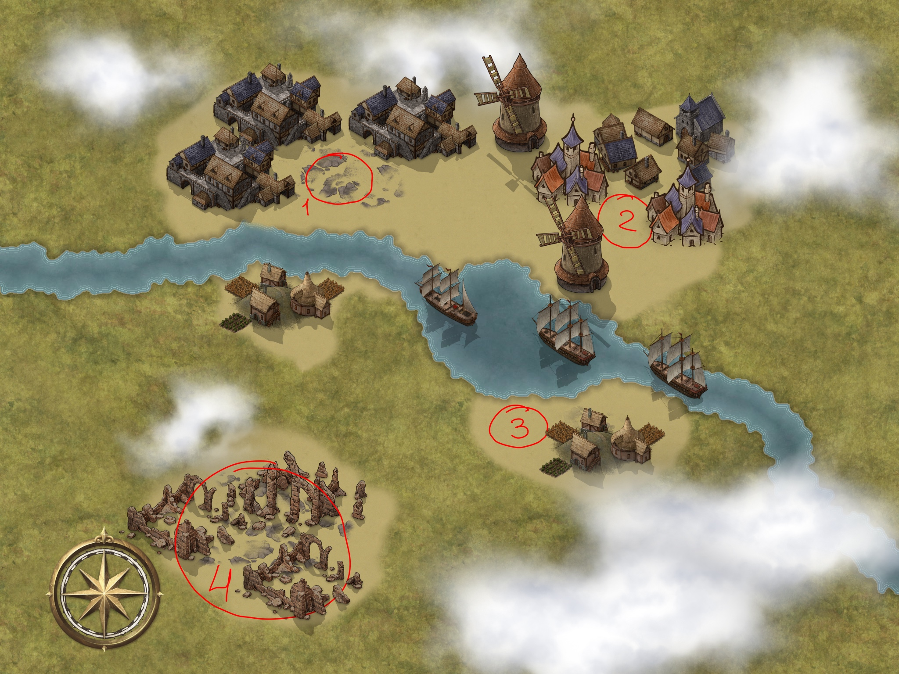

# Полные тексты материалов игры

Справочный архив: читать нужный источник по ссылке из [GAME_CONTEXT.md](../GAME_CONTEXT.md), а не целиком при восстановлении контекста. Здесь сохранены старые варианты и вопросы; актуальные решения находятся в основном своде.

## Источники

- [S01](#s01)
- [S02](#s02)
- [S03](#s03)
- [S04](#s04)
- [S05](#s05)
- [S06](#s06)
- [S07](#s07)
- [S08](#s08)
- [S09](#s09)
- [S10](#s10)

## S01. Аудиторная_работа_8 (1).pptx

Извлечённый текст. Разметка адаптирована; исходный файл сохранён.

### Слайд 1

Аудиторная работа

Неделя 8

### Слайд 2

Как изменится поведение участника после игры?

- Игрок поймёт важность командной работы при достижении цели.

- Игрок научится анализировать ситуацию с точки зрения необходимых навыков и имеющихся ресурсов.

### Слайд 3

3 рефлексивных вопроса:

- Что будет чувствовать игрок после игры?

- Какие выводы про себя сделает игрок после игры?

- Заметит ли игрок изменения в себе через неделю/месяц после игры?

### Слайд 4

Ощущения игрока во время игры

- Стресс из-за ограниченного времени на ход и действие

- Растерянность от случайный действий

- Азарт от наличия выбора

### Слайд 5

Позиция игрока

Участники смог попробовать разные позиции в игре, такие как:

- герой

- член команды

- свидетель

- наблюдатель системы

### Слайд 6

Пересказ игрока

«Это была интересная игра про Вавилон, которая не только развлекла и позволила провести с удовольствием время, но и показала важность работы в команде и в коммуникации, а также позволила мне оценить свои навыки.»

## S02. Бриф Мактерская игр-2.pdf

Извлечённый текст. Разметка адаптирована; исходный файл сохранён.

### Страница 1

Команда:
     -​  Кондратьев Георгий
     -​  Летучев Игорь
     -​  Семенова Алина
     -​  Мартыщенко Тимофей
     -​  Замараев Александр
     -​  Бородина Мелисса

                      ТЗ

 Место игры                           Аудитория со столами

 Цель                               Оценить компетенции студентам и на
                                       основе этого посоветовать soft-курсы

 Длительность                            2-3 часа

 Формат                             Командая офлайн игра

 Игроки                                 10-100 человек

 Дополнительно                      Необходимо учесть тот факт, что не всем
                                         будет изначально комфортно работать в
                                        команде, также возможно, что некоторые
                                         участники из одной команды могут
                                       изначально знать друг друга, что может
                                       повлиять на процесс игры

 Образовательный результат           За 3 часа студент сможет применить
                                     различные софт-компетенции
                                         (Коллаборативность, Коммуникация) и по
                                        итогам игры получить оценку своих
                                      навыков по заданной шкале и советы по
                                        их развитию. Также в фоновом режиме
                                         будут оцениваться иные компетенции,
                                       оценки которых и рекомендации по
                                     которым будут даны некоторым
                                         студентам, которые их проявляли

 Ограничения                           Предполагается, что в одной команде
                                         будет от 3 до 7 человек (в зависимости
                                          от количества игроков – больше людей,
                                   больше команды)

## S03. Бриф на разработку бизнес-игры для оценки софт-компетенций студентами.docx

Извлечённый текст. Разметка адаптирована; исходный файл сохранён.

<!-- Блок 1 -->
Бриф на разработку образовательной игры для оценки компетенций студентов внутри Центрального Университета

<!-- Блок 2 -->
О заказчике

<!-- Блок 3 -->
Центральный Университет — https://cu.ru/ — Автономная некоммерческая организация высшего образования "Центральный университет", первый в России STEM-Университет, обучающий специалистов в области искусственного интеллекта, бизнеса и разработки, медиа-искусства, дизайна и естественных наук.

<!-- Блок 4 -->
Кто заказчик

<!-- Блок 5 -->
Людмила Каменецкая, академический лид направления гибких навыков ЦУ в бакалавриате. 

<!-- Блок 6 -->
Контакты для связи

<!-- Блок 7 -->
Tайм: @l.kamenetskaya

<!-- Блок 9 -->
Что нужно разработать? 

<!-- Блок 10 -->
Каждый семестр студенты выбирают себе софт-курсы для того, чтобы к концу обучения могли иметь полный набор компетенций специалиста уровня миддл или сеньор (соотвествующие или превосходящие ожидания индустрии, науки и предпринимательского сообщества) и перед ними встает задача, чтобы определить степень развития компетенций на момент сейчас по всем ожидаемым навыкам и закладываемым в дисциплинах результатах для себя (что уже развито, что требует развития, какие есть сильные стороны и какие области требуют развития).Задача: разработать игровую симуляционную модель на 2-3 часа, через которую каждый ее участник поймет для себя, какие у него компетенции уже развиты и на каком уровне, какие есть западающие зоны, что требуется для их развития и какие инструменты внутри обучения помогут ему эти компетенции развить. То есть по итогу игры у каждого участника должна быть картинка с компетенциями и их степенью развития, рекомендации курсов, книг и программ, которые учащийся может для себя использовать, обратной связью от нескольких игроков, с кем он вместе играл в симуляторе и возможность задать каждому из них вопрос после игры.С точки зрения участника игра не должна быть очень сложной и тяжелой, при этом должна быть достаточная степень сложности, чтобы игра могла быть интересна разному уровню участников.

<!-- Блок 11 -->
Какие есть ограничения и требования? 

<!-- Блок 12 -->
● Игра должна отражать реальные задачи или их вариации и давать опыт для каждого участника и иметь практическую пользу (даже если человек не прочитает после игры для себя информацию - чтобы получаемый опыт в игре был ему полезен и интересен)● Длительность игры: 2-3 часа. Правила игры и вводная по игре - не более 15-20 минут. То есть дополнительные правила могут постепенно вводится в игру или быть максимально емкими и не перекрученными с самого начала.● В идеале, чтобы в начале была конкуренция, а дальше стратегия сотрудничества давала больше очков и финальный выигрыш внутри игры.

<!-- Блок 13 -->
● Если есть возможность настроить индивидуальные доступы и подключить участников в общему пространств для сбора мнений и обратной связи - будет удобно и практически интересным. 

<!-- Блок 14 -->
● Игра должна быть очной, но иметь возможность быть переведенной в онлайн, чтобы можно было получить быструю оценку для себя, если ты находишься в другом городе.

<!-- Блок 15 -->
● Количество участников одновременно - от 10 до 100 человек.

<!-- Блок 16 -->
● Если будет ответвление с индивидуальными кейсами и прохождениями заданий - будет преимуществом для проб на меньшие, чем 10 человек группы.

<!-- Блок 17 -->
Готовность давать команде разработки материалы? Да.Модель компетенций для анализа лежит здесь.

### Внешние ссылки, сохранённые в исходнике

- https://cu.ru/
- https://docs.google.com/spreadsheets/d/1hoHkJBdZaNEM1aShg6SD9AcYkvaaEEclJ7XVmA3f50M/edit?gid=957478399#gid=957478399

## S04. ДЗ_2 (2).pptx

Извлечённый текст. Разметка адаптирована; исходный файл сохранён.

### Слайд 1

ДЗ 2

Команда: 

Семенова Алина

Замараев Александр

Кондратьев Георгий

Бородина Мелисса

Летучев Игорь

Мартыщенко Тимофей

10/15/26

### Слайд 2

Вводные

Проблема: Непонятно, с чего начинать

- Каждый семестр студенты выбирают софт-курсы, чтобы к выпуску иметь компетенции уровня миддл или сеньор. Для выбора нужно знать свой уровень сейчас.

Задача: Игра-симулятор на 2-3 часа

- Участник понимает, какие компетенции у него развиты и на каком уровне, где западающие зоны и что поможет их развить.

### Слайд 3

Концепция

Краткое описание ЦА – студенты ЦУ, которые хотят оценить уровень своих софт-скиллов

Образовательный результат – за 3 часа студенты смогут применить свои софт-скиллы и по итогу игры получат оценку своих навыков по заданной шкале и рекомендации по их улучшению

Описание игры – игроки в командах должны построить «вавилонскую башню». В процессе игры возникают различные препятствия в виде сезонных особенностей и природных событий, а также иные модификаторы игры.

Что получает игрок: Картина компетенций и рекомендации

- Уровень по компетенциям, рекомендации курсов, книг и программ, обратная связь игроков и возможность задать им вопрос.

Атмосфера: Нетяжёлая, но с глубиной

- Достаточно сложная, чтобы быть интересной игрокам разного уровня. Правила и вводная — не более 15-20 минут

Механика: Конкуренция и сотрудничество, постоянное изменение мира игры

- Механики конкуренции и сторудничества позволяют проверить мягкие навыки, а постоянное изменение мира приближает игру к реальности.

Формат: Офлайн, с онлайн версией

### Слайд 4

Фрейм

Какой фрейм взяли – исторический фрейм, легенда о Вавилонской башни

Почему выбрали его – фрейм отлично подходит под тему софт-скиллов – чтобы построить башню, людям необходимо уметь коммуницировать, договариваться между собой, проявлять лидерские навыки, креативность и т д, особенно когда между ними проблемы с коммуникацией (в легенде все стали говорить на разных языках)

Какие есть элементы:

Роли – «прорабы» и «работники»

Тип отношений – горизонтальные внутри команд и среди команд

Контекст – кабинет

### Изображение

Вложенный PNG содержит крупный чёрный знак вопроса на светлом фоне. Дополнительного текста нет.

## S05. Концепт документ софты.docx

Извлечённый текст. Разметка адаптирована; исходный файл сохранён.

<!-- Блок 1 -->
Концепт мира

<!-- Блок 3 -->
Фракции-команды:

<!-- Блок 4 -->
Городская администрация

<!-- Блок 5 -->
Архитекторы

<!-- Блок 6 -->
Строители

<!-- Блок 7 -->
Мирные жители

<!-- Блок 8 -->
Тайный орден (церковь)

<!-- Блок 9 -->
Торговцы

<!-- Блок 11 -->
Подробнее:

<!-- Блок 12 -->
Городская администрация - управляет городом, предлагает идею башни и видит в ней ключ к развитию города. Некоторые представители городской администрации имеют магазины и рестораны в центре города, и у кого-то они пострадают при строительстве, а кто-то сможет выиграть за счёт привлечённых туристов. Все тайно хотят сэкономить на строительстве.

<!-- Блок 13 -->
Архитекторы проектируют башню. Их задача построить её привлекательной для туристов и при этом вписать башню в ландшафт.

<!-- Блок 14 -->
Строители пытаются построить башню по качеству, несмотря на фантазии архитекторов.

<!-- Блок 15 -->
Мирные жители в целом не против постройки башни, но против того что она будет строиться в жилом районе или на руинах.

<!-- Блок 16 -->
Тайный Орден знает, что строительство башни противоречит законам Высшей силы, поэтому всячески препятствует строительству. Ордену особенно противна мысль, что башня может стоять рядом с их священным храмом.

<!-- Блок 17 -->
Торговцы в целом заинтересованы в строительстве башни, при определённых условиях могут помочь со строительством, но все тоже в тайне хотят сэкономить.

<!-- Блок 19 -->
Ведущий:

<!-- Блок 20 -->
Высшая сила - создаёт правила игры, вводит ограничения, создаёт ивенты

<!-- Блок 21 -->
Проблема:

<!-- Блок 22 -->
Городская администрация решает заняться развитием города и предлагает построить башню. Башня решает несколько проблем города: 

<!-- Блок 23 -->
Проблема бизнеса: офисы многих предпринимателей, торговых альянсов и мастерские раскиданы по городу, что мешает налаживать деловые контакты. Башня станет деловым центром города.

<!-- Блок 24 -->
Проблема туризма: в городе нет значимых достопримечательностей, поэтому туристический поток города маленький. Стабильный туристический поток привлёк бы инвестиции и прибыль, поэтому башня также должна стать туристическим объектом.

<!-- Блок 25 -->
Социальная проблема: в городе практически нет зеленых зон, парков и скверов, что вызывает недовольство со стороны мирных жителей. Вокруг башни планируется разбить парк, но для этого должно быть достаточно территории.

<!-- Блок 27 -->
Места постройки башни:

<!-- Блок 28 -->
Городская площадь: Плюсы: центр города - удобно торговцам и предпринимателям, хорошее место для туристов; Минусы: мало места - парк построить не получиться, далеко от жилого квартала, дорогая земля, при строительстве необходимо убрать некоторые магазины и рестораны на площади, башня будет прямо рядом со зданием Тайного Ордена.

<!-- Блок 29 -->
Жилой квартал: Плюсы: местным удобно добираться, дешёвая земля; Минусы: мало места - для постройки башни требуется снести часть жилых домов, бизнесу неудобно переезжать, не туристическое место.

<!-- Блок 30 -->
Другой берег реки: Плюсы: город начнёт развиваться равномерно, а не только северный берег, самая дешёвая земля, много места - можно разбить огромный парк, есть туристический потенциал, через реку от жилого квартала; Минусы: нужно построить нормальный мост, имеющегося парома не хватит, дополнительные затраты на доставку материалов, очень мягкая почва - дополнительные затраты на фундамент, бизнес не заинтересован в переезде. Нюанс: если заинтересовать торговцев в строительстве башни на этом месте, они могут помочь с перевозкой материалов, что снизит затраты.

<!-- Блок 31 -->
Руины: Плюсы: дешёвая земля, много места - можно разбить огромный парк, есть туристический потенциал; Минусы: нужно построить нормальный мост и дорогу, дополнительные затраты на доставку материалов, бизнес не заинтересован в переезде, сопротивление со стороны жителей - так как руины памятник исторического наследия, а для строительства башни надо снести часть руин. Нюанс: если выбрано это место, потом в игре может обнаружиться, что исследования почвы было проведено неправильно, и из-за песчаной почвы нужно укреплять фундамент, а это дополнительные затраты.

### Текстовое описание карты

Иллюстрация города у реки. Сверху расположены плотная застройка, мельницы и группа зданий с синими крышами; на реке показаны суда и переправа. На нижнем берегу — отдельные дома, юго-западнее — руины с каменными колоннами. Красными обводками отмечены четыре площадки: 1 — среди верхней левой городской застройки; 2 — возле группы зданий справа; 3 — на нижнем берегу у домов; 4 — руины внизу слева. Сопоставление с перечнем мест (площадь, жилой квартал, другой берег, руины) следует из контекста документа; сами названия на карте не подписаны. Это иллюстрация выбора площадки, численных расстояний и стоимости на ней нет.

## S06. Семинар 1 — глубинные интервью (1).pdf

Текст восстановлен вручную по изображениям всех 7 страниц: исходный текстовый слой PDF теряет кириллицу. Порядок карточек сохранён; переносы строк и оформление нормализованы. Это текст презентации с итогами интервью, а не стенограммы самих интервью. Выделение цветом не воспроизводится.

### Страница 1

ЦУ · софт-компетенции. (Глубинные интервью · сентябрь 2026)

Семинар 1. Общие моменты с глубинных интервью.

Петр Калашников. Дубовский Иван. Булатов Артём.

### Страница 2. Глубинное интервью: Екатерина

Бизнес-информатика, Финансовый университет · гуляет с друзьями, смотрит фильмы

#### (01) Самооценка — Коммуникабельная

Находит подход к людям, любит общаться. Но в вузе бывает сложно найти общий язык с другими студентами.

#### (02) Опыт оценки — Оценку навыков не проходила

Картину своих компетенций использовала бы при устройстве на работу.

#### (03) Оценка другими — Полезна, если просит сама

К оценке от студентов относится нейтрально. Непрошеный фидбэк о себе слышать не хочет.

#### (04) Реакция на игру — Скорее пошла бы, зимой

Реакция позитивная, если негатив не повлияет на будущее. Не пойдёт, если игра в выходной, когда надо делать ДЗ.

#### (05) Ценность результатов — Фидбэк игроков — первое

Важно знать, как тебя видят другие. Дальше профиль, последние — рекомендации.

#### (06) Механика и фидбэк — Хочет выиграть, но спокойно

Смена конкуренции на сотрудничество — ок, 2–3 часа — нормально. Критику писать неловко, если знают автора.

Выделено — наблюдения для общих выводов.

### Страница 3. Глубинное интервью: Тихон

ЦУ, разработка, закончил 2-й курс

#### (01) Выбор софта — Сначала совет, теперь ИИ

Первый раз курсы отобрала девушка. «Креативные техники» взял, чтобы чаще быть лидом. Сейчас просит у ИИ топ-5.

#### (02) Польза курсов — Публичка — да, креатив — нет

Публичка вывела из зоны комфорта, дала уверенность. Креативу хватило бы пары занятий. Минус — обязательная посещаемость.

#### (03) Опыт оценки — Скептик к психологии

Бизнес-игра при поступлении в ЦУ: час молча, 20–30 мин общения. Результат разошёлся с самооценкой.

#### (04) Честная оценка — Видеть, на чём основан вывод

Зафиксированные наблюдения, метрики, «внутрянка». Иначе это «гадание на кофейной гуще».

#### (05) Оценка другими — На отборе вредна, сейчас ок

На поступлении честно писать бы не стал. Сейчас готов к фидбэку в неформальном формате, с выбором: анонимно или нет.

#### (06) Реакция на игру — Пошёл бы, лучше офлайн

Зацепило «за 3 часа понять, какие софты нужны». Лучший момент — 2-й курс, когда начинаются собеседования.

Выделено — наблюдения для общих выводов.

### Страница 4. Глубинное интервью: Таня

Другой вуз · интервью шло в спешке, часть вопросов осталась без ответа

#### (01) Софт-курсы — Считает навыки прокачанными

Софты специально не брала. Обязательный курс оказался полезнее, чем ждала.

#### (02) Опыт оценки — Несколько бизнес-игр

Игра ЦУ, айтишные каникулы: придумать бизнес и работать в случайной команде. Фидбэк вживую и письменный листок.

#### (03) Честная оценка — Наблюдатели слушают и пишут

Оценка по шкалам с конкретными моментами — такой фидбэк помнишь и спустя время.

#### (04) Идеальный профиль — Обсудила бы с психологом

Сейчас другие приоритеты, но бесплатный анализ взяла бы.

#### (05) Формат игры — Нужен конкретный размер

Разброс «10–100 человек» не нравится. Идеально 2–2,5 часа с перерывом, 3 часа — тоже ок.

#### (06) Ценность результатов — Живой фидбэк — первое

Дальше профиль. Курсы и книги найдёт сама или с ИИ, поэтому рекомендации последние.

Выделено — наблюдения для общих выводов.

### Страница 5. Общие моменты

3 интервью: Екатерина, Тихон, Таня

#### (01) Выбор софта — Выбирают не по пробелам

Тихону курсы сначала отобрала девушка, теперь топ-5 даёт ИИ. Таня софты не брала: считает, что и так прокачана.

#### (02) Самооценка — Нет точки отсчёта

У Тихона оценка разошлась с самооценкой. Екатерина считает себя коммуникабельной, но в вузе ей трудно найти общий язык.

#### (03) Ценность — Живой фидбэк важнее профиля

У всех троих фидбэк на 1-м месте. Профиль и рекомендации ниже: курсы можно найти самому или с ИИ.

#### (04) Доверие — Верят наблюдениям, не тестам

Нужно видеть, на чём основан вывод: записанные моменты, шкалы, метрики. Иначе профиль — «гадание».

#### (05) Безопасность — Фидбэк без последствий

Негатив не должен влиять на будущее, открыто критиковать неловко. На отборе взаимная оценка токсична.

#### (06) Формат — 2–2,5 часа, офлайн

С перерывом, не в выходные, с конкретным размером группы. Лучший момент — когда начинаются собеседования.

Выделено — главное для дизайна игры.

### Страница 6. Что целим: результат по CABD

Бриф / образовательный результат

**C — condition · условие:** По итогам 2–3-часовой игры-симуляции на реальных задачах, опираясь на свои действия в игре и обратную связь других игроков,

**A — audience · кто:** студент бакалавриата ЦУ

**B — behavior · что делает:** определяет уровень развития своих компетенций по модели ЦУ и выбирает инструменты для их развития,

**D — degree · критерий:** так, что по каждой компетенции указан уровень с примером из игры, выделены 2–3 сильные стороны и 2–3 зоны развития, и на каждую зону есть хотя бы один софт-курс ЦУ, книга или программа.

Фидбэк игроков — источник данных для оценки, а не отдельная цель.

### Страница 7. Кейсы для вдохновения

Ресёрч / аналоги

#### (01) Лидеры России · ЭКОПСИ — Групповая игра с наблюдателями

Группы по 10 человек решают кейсы и делят ресурсы. Команды собираются случайно, каждого оценивают несколько экспертов.

→ Берём: развивающий фидбэк с рекомендациями — его получили 90 тыс. участников.

#### (02) Unilever × Pymetrics — Мини-игры вместо первого собеседования

Короткие онлайн-игры на риск, логику и внимание. Каждый кандидат получает пару страниц отчёта о себе.

→ Берём: индивидуальный онлайн-трек для групп меньше 10 человек.

#### (03) Win as Much as You Can · Harvard PON — Дилемма заключённого на четверых

10 раундов выбора X или Y, договариваться можно только перед 5, 8 и 10 раундом. 15 мин игры, 30–45 мин разбора.

→ Берём: механику «сначала конкуренция, потом сотрудничество».

#### (04) Школа 21 · Сбер — Взаимная проверка за очки

Студенты проверяют чужие проекты по чек-листу и за это получают баллы на проверку своего.

→ Берём: фидбэк игрокам как часть игровой экономики.

Источники, указанные на слайде: ecopsy.ru · forbes.com · pon.harvard.edu · 21-school.ru.

Примечание к расшифровке: сведения об аналогах переданы из презентации, внешняя проверка этих утверждений в рамках текущей задачи не выполнялась.

## S07. созвон.docx

Извлечённый текст. Разметка адаптирована; исходный файл сохранён.

<!-- Блок 1 -->
1. Цели, счёт и финал

<!-- Блок 2 -->
Частные цели и глобальная цель

<!-- Блок 3 -->
Частные цели стоит делать. Без них нет конфликта интересов, а значит, нет переговоров, торга и союзов, то есть тех ситуаций, где проявляются компетенции. Обсудить нужно, как связать их с башней. Есть три варианта:

<!-- Блок 4 -->
Жёсткий порог. Частные очки засчитываются, только если башня построена. Это сильно толкает к сотрудничеству, но любой провал обнуляет всех, и от этого может быть обидно.

<!-- Блок 5 -->
Множитель. Итог = частные очки × коэффициент готовности башни (например, 0 / 0,5 / 1 / 1,5). Тянуть одеяло на себя можно, но выгоднее договариваться. Такой вариант лучше всего ложится на требование брифа «сначала конкуренция, потом сотрудничество».

<!-- Блок 6 -->
Независимые цели. Ближе к реальности, но есть риск, что команды просто разойдутся по своим задачам.

<!-- Блок 7 -->
Тайный орден. Его интерес — чтобы башни не было, и это ломает любую схему «частное работает только при глобальном». Варианты: Орден выигрывает, если башня стоит не у храма или если он получил уступку. Либо Орден — роль-провокатор, которая проверяет, как команды справляются с саботажем. Будем ли мы говорить игрокам о целях Ордена?

<!-- Блок 9 -->
Вопросы

<!-- Блок 10 -->
Цели. Цели фракций у нас есть. Нужны ли ещё личные цели ролей внутри фракции, и как сделать их механикой (уникальное действие, ресурс, информация), а не просто легендой?

<!-- Блок 11 -->
Счёт. Ведём ли очки, и если да, то на каком уровне: фракции, игроки или только общая башня? Или обходимся без очков (условия «выполнено / нет», ресурсы, эпилог)?

<!-- Блок 12 -->
Мотивация. Что заставит фракцию отстаивать свои интересы, а не просто сдаться ради башни: последствия по ходу игры, привилегии, публичное табло или недовольство, которое бьёт по башне?

<!-- Блок 13 -->
Финал. Что считается хорошей башней в конце? Просто достроенная или та, что решила проблемы города и учла интересы фракций? И что происходит, если чьими-то интересами пренебрегли?

<!-- Блок 14 -->
Победа отдаётся при выполнении ЛИБО командной ЛИБО общей цели. Если выполнено обе цели, это ++

<!-- Блок 15 -->
Противоречивые цели на личных целях - как минимум выполнение личных целей будет провоцировать конфликт, как максимум - не все команды смогут выполнить личные цели.

<!-- Блок 16 -->
2. Отдельные роли

<!-- Блок 17 -->
Плюсы. Асимметрия информации — это готовый генератор переговоров: Флора и Кристиан из одного совета, но хотят противоположного. Кроме того, роль — самый естественный способ поставить человека в непривычную ситуацию, то есть она прямо работает на выход из зоны комфорта (раздел 3).

<!-- Блок 18 -->
Неравенство. Если у одного яркая роль, а у другого её нет, у второго меньше поводов проявить себя, и оценка выйдет несправедливой. Вариант: у каждого есть хотя бы личная карточка, а развёрнутые роли — только у ключевых фигур (глава Ордена, главный архитектор).

<!-- Блок 19 -->
Общая цель - башня - ведёт к победе весь стол

<!-- Блок 20 -->
Командная цель - при выполнении ведёт к победе - команду

<!-- Блок 21 -->
Личная цель - даёт баф герою помогая реализовать командную цель? - скорее нет мы умрём всё это связывать

<!-- Блок 22 -->
Команда - 4 человека - один человек одна функция

<!-- Блок 23 -->
Раз в кол-во раундов/4 - свап

<!-- Блок 24 -->
1) 

<!-- Блок 25 -->
1) лидер

<!-- Блок 26 -->
2) менеджер ресурсов

<!-- Блок 27 -->
3) АРХИТЕКТОР БАШНИ АХАХАХА - НЕ ПОНИМАЮ КАКУЮ ФУНКЦИЮ ПРОВЕРЯЕТ ЭТА РОЛЬ НО СМЕШНО

<!-- Блок 28 -->
4) дипломат

<!-- Блок 29 -->
Одинаковые функции под своей легендой

<!-- Блок 31 -->
3. Как мы видим выход из зоны комфорта

<!-- Блок 32 -->
Давайте скажем да / нет на варианты.

#### Таблица (блок 33)

Строка 1: Вариант | Суть | Решение
Строка 2: Ротация позиций | Человек не сидит в одной роли всю игру: меняется спикер команды, меняется лидер в раунде, кто-то переходит в другую фракцию как посол. | ДА
Строка 3:  |  | 
Строка 4:  |  | 
Строка 5:  |  | 
Строка 6:  |  | 
Строка 7:  |  | 
Строка 8: Дефицит и кризис | Ресурсов меньше, чем нужно всем, плюс внезапные события (почва на руинах, сезоны). Это вытаскивает переговоры, приоритизацию и управление стрессом. | 

<!-- Блок 34 -->
4. Механики

<!-- Блок 35 -->
5. Остальные вопросы

<!-- Блок 36 -->
Какие компетенции оцениваем? В модели 6 блоков и около 40 под-компетенций, все за 2–3 часа не покрыть. Какие берём в фокус?

<!-- Блок 37 -->
Как фиксируем доказательства? Из интервью: люди верят наблюдениям («вот момент, где ты…»), а не цифрам.

<!-- Блок 38 -->
Длительность: 2–2,5 часа с перерывом (как просили в интервью) или 3 (как в брифе)?

<!-- Блок 39 -->
Что физически происходит в игре? Строим башню из частей на поле или башня — это шкала?

<!-- Блок 40 -->
Нужны ли все 6 фракций? Не слишком ли пассивны «Мирные жители»?

<!-- Блок 41 -->
Выбор места постройки — это первое большое переговорное событие? Сколько оно длится?

<!-- Блок 42 -->
Какие ивенты есть у Высшей силы и что каждый из них проверяет?

<!-- Блок 43 -->
Как вписываем мотив вавилонского «смешения языков» (барьер в коммуникации) в механику?

## S08. Чек-лист оценки soft-skills компетенций - чек-лист 0-3.pdf

Текст извлечён по ячейкам таблицы в исходном порядке PDF. Переносы строк внутри ячеек свёрнуты; пустые служебные колонки не воспроизводятся. Номера строк относятся к таблице соответствующей страницы.

### Страница 1

#### Строка 1

Чек-лист оценки компетенций

#### Строка 2

Дата заполнения

#### Строка 3

ФИО оцениваемого

#### Строка 4

ФИО оценщика

#### Строка 5

Оценка проводится по поведенческим маркерам по шкале:

#### Строка 6

0 | Отсутствует, плохо развит

#### Строка 7

1 | Хорошо развит, но есть ошибки, не полный цикл

#### Строка 8

2 | Ожидаемый уровень у выпускника

#### Строка 9

3 | Отлично развит, в некоторых аспектах превосходит ожидание

#### Строка 10

Контекст

#### Строка 11

Задача: избегать 0, гарантировать 1, стремиться к 2, поощрять 3 Студент обязательно касается всего контекста софт скиллов, но с разной глубиной в зависимости от потребностей Потребность определяется и возвращается: наставником, карьерным центром, преподавателями курсов, работодателем, ассессментом

#### Строка 12

Компетенция | Под-компетенция | Описание под-компетенции | 0 - отсутствует, плохо развит | 1 - хорошо развит, но есть ошибки, не полный цикл | 2 - ожидаемый уровень | 3 - отлично развит, в некоторых аспектах превосходит ожидание | Оценка | Конкретные примеры и пояснения к под-компетенции | Дополнительные комментарии

#### Строка 13

**Компетенция:** Коммуникация

**Под-компетенция:** Умение презентовать

**Описание / поведенческий аспект:** Структурирование информации: способность организовать материал логично и последовательно.

**Уровень 0:** Не структурирует информацию и выдает поток мыслей, перескакивает с темы на тему и уходит от основной линии, из-за чего сложно понять, о чем идет речь.

**Уровень 1:** Студент подготовил презентацию с общей структурой и старается придерживаться сторилайна, но местами перескакивает с темы на тему, что затрудняет понимание.

**Уровень 2:** Презентация имеет четкую структуру с логичными и плавными переходами, что помогает слушателям следить за ходом выступления.

**Уровень 3:** Стратегически выстраивает структуру презентации под цель, аудиторию и контекст: чётко формулирует ключевое сообщение, логически подчиняет ему весь материал, использует смысловые акценты и может гибко перестраивать структуру в ходе выступления без потери целостности.

#### Строка 14

**Описание / поведенческий аспект:** Использование визуальных средств: умение применять слайды, графики и другие визуальные элементы для улучшения восприятия информации

**Уровень 0:** Слайды полностью текстовые или перегружены мелким текстом, отсутствуют графики и таблицы, изображения не отражают суть и используются только для красоты.

**Уровень 1:** Слайды содержат визуальные элементы и изображения по теме, но перегружены текстом.

**Уровень 2:** Слайды содержат визуальные элементы и изображения по теме, используются краткие тезисы, понятные графики и схемы, которые помогают усвоить информацию.

**Уровень 3:** Использует визуальные средства целенаправленно: проектирует слайды под ключевые сообщения и аудиторию, выстраивает визуальную иерархию, расставляет смысловые акценты и использует графики, схемы и образы для поддержки логики изложения.

#### Строка 15

**Описание / поведенческий аспект:** Адаптация стиля презентации: умение подстраивать стиль общения под аудиторию (технические специалисты, менеджеры, клиенты).

**Уровень 0:** Использует технические термины и сложные выражения в аудитории, не знакомой с темой.

**Уровень 1:** Стиль в целом подходит аудитории, но местами объяснения слишком сложные или слишком простые.

**Уровень 2:** Речь адаптирована под аудиторию, сложные термины заменяются понятными примерами.

**Уровень 3:** Адаптирует стиль выступления под аудиторию (ускорение, замедление, углубление в детали, стратегическая перспектива) и использует все ключевые средства выразительности и невербальную коммуникацию.

#### Строка 16

**Описание / поведенческий аспект:** Управление временем: способность укладываться в отведенное время и эффективно распределять его между различными частями презентации

**Уровень 0:** Презентация затянута или слишком коротка, пропускаются важные детали и не остается времени на вопросы.

**Уровень 1:** По времени укладывается, но теряет ритм, добавляя незначительные детали.

**Уровень 2:** Студент укладывается в регламент, контролирует время и оставляет его на вопросы.

**Уровень 3:** Задает вопросы в аудиторию и модерирует групповую дискуссию во время своего выступления. Управляет внимание аудитории, включает менее активных и заинтересованных слушателей в процесс обсуждения и анализа информации.

#### Строка 17

**Описание / поведенческий аспект:** Ответы на вопросы: умение четко и уверенно отвечать на вопросы слушателей, поддерживая диалог.

**Уровень 0:** Путается в ответах, теряется, не может объяснить основные моменты и избегает диалога с аудиторией.

**Уровень 1:** На вопросы отвечает, но иногда теряет уверенность или забывает часть материала, старается вести диалог с аудиторией, но делает это не всегда уверенно.

**Уровень 2:** Уверенно отвечает на вопросы и поясняет сложные моменты.

**Уровень 3:** Проблематизирует обсуждения и задает тон дискусии между слушателями.

#### Строка 18

**Под-компетенция:** Умение вести переговоры

**Описание / поведенческий аспект:** Подготовка к переговорам: исследование темы, понимание потребностей сторон и выработка стратегии

**Уровень 0:** Приходит на переговоры без подготовки, не изучает тему, интересы сторон и возможные вопросы, не имеет данных и аргументов для своей позиции.

**Уровень 1:** Готовится к переговорам и знакомится с базовой информацией, понимает основные интересы сторон, но не учитывает возможные проблемы и вопросы, из-за чего теряется при уточнениях.

**Уровень 2:** Тщательно готовится к переговорам, изучает потребности всех сторон, возможные риски и вопросы, предлагает план с учетом возможностей участников.

**Уровень 3:** Во время переговоров рассматривает 2-3 варианта действий, превращает риски в возможности и предлагает новые выгодные для обеих сторон сценарии развития событий.

#### Строка 19

**Описание / поведенческий аспект:** Активное слушание: способность внимательно слушать собеседника, выявлять его интересы и потребности

**Уровень 0:** Во время обсуждений отвлекается, не слушает других, не задает уточняющих вопросов и теряет нить разговора.

**Уровень 1:** В целом слушает других, но иногда отвлекается, перебивает и редко задает уточняющие вопросы, из-за чего упускает важные детали, активное слушание часто носит формальный характер.

**Уровень 2:** Активно слушает, поддерживает контакт, задает уточняющие вопросы, перефразирует и стремится понять точку зрения других.

**Уровень 3:** Учитывает свои интересы и интересы партнера по переговорам, прогнозирует возможные исходы и продумывает для них план развития и возможные способы синхронизации позиций.

#### Строка 20

**Описание / поведенческий аспект:** Аргументация: умение обосновывать свою позицию и предлагать решения, которые учитывают интересы обеих сторон.

**Уровень 0:** Не может четко сформулировать и обосновать свою позицию, говорит общими фразами и не защищает свои идеи при возражениях.

**Уровень 1:** Старается аргументировать позицию, но аргументы нередко поверхностны и основаны на личных предположениях, при вопросах теряется и выглядит неубедительно.

**Уровень 2:** Четко формулирует и обосновывает позицию, подкрепляя аргументы фактами, статистикой и примерами, уверенно отвечает на вопросы и сомнения.

**Уровень 3:** Во время подготовки к переговорам продумывает аргументы и контраргументы партнеров по переговорам, готовит статистику и нужные данные для поиска выгодных решений.

#### Строка 21

**Описание / поведенческий аспект:** Управление конфликтами: навыки нахождения компромиссов и разрешения споров в ходе переговоров

**Уровень 0:** Теряется в конфликтных ситуациях, либо выходит из обсуждения, либо настаивает на своем, не учитывая мнения других.

**Уровень 1:** Пытается найти компромисс, но решения поверхностны, не всегда учитывают интересы всех сторон и часто направлены на быстрое завершение спора.

**Уровень 2:** Спокойно реагирует на конфликты, выслушивает все стороны и предлагает решения, учитывающие интересы каждого.

**Уровень 3:** Выступает в роли медиатора в сложных ситуациях (управляет своим эмоциональным состоянием и способствует переводу спорных ситуаций в решаемые).

#### Строка 22

**Описание / поведенческий аспект:** Заключение соглашений: способность формулировать и фиксировать достигнутые договоренности

**Уровень 0:** Не фиксирует договоренности, после встреч отсутствуют записи и понимание дальнейших шагов.

**Уровень 1:** Фиксирует договоренности частично, упуская детали, такие как сроки и ответственные.

**Уровень 2:** Четко фиксирует договоренности и после встречи оформляет задачи с указанием сроков и ответственных.

**Уровень 3:** Во время фиксации договоренностей и принимаемых решений - проговаривает области ответственности каждой из сторон и первые шаги внедрения договоренностей.

#### Строка 23

**Описание / поведенческий аспект:** Четкость и лаконичность: умение выражать мысли ясно и кратко, избегая излишней сложности.

**Уровень 0:** Излагает мысли запутанно и с лишними деталями, использует избыточно сложный стиль, из-за чего основная мысль трудно уловима.

**Уровень 1:** Понимает важность краткости, но часто добавляет малозначимые детали, которые не влияют на основной смысл.

**Уровень 2:** Пишет по существу, избегая лишних деталей и сложных формулировок, сообщения понятны с первого прочтения и содержат только важную информацию с учетом контекста и формата общения.

**Уровень 3:** Пишет тексты, которые легко воспринимаются читателями, структура текста удерживает внимание. В текстах соблюдается идеальный баланс краткости и информативности.

#### Строка 24

**Описание / поведенческий аспект:** Структурирование текста: способность организовать текст в логические блоки с использованием заголовков, списков и абзацев.

**Уровень 0:** Пишет без структуры, одним сплошным текстом, без заголовков и разделения, из-за чего сложно выделить ключевые моменты.

**Уровень 1:** Старается структурировать текст, использует заголовки и абзацы, но делает это не всегда логично, из-за чего идеи смешиваются.

**Уровень 2:** Логично структурирует текст, использует разделы, абзацы и списки, благодаря чему основной смысл сразу очевиден и нужная информация легко находится.

**Уровень 3:** Использует структурирующие элементы для текста (заголовки, списки, схемы) так, чтобы любой читатель интуитивно находил нужную информацию, такой текст становится инструментом обучения и вдохновения.

#### Строка 25

**Под-компетенция:** Письменная коммуникация

**Описание / поведенческий аспект:** Адаптация стиля письма: умение подстраивать стиль написания под целевую аудиторию (коллеги, клиенты, руководство)

**Уровень 0:** Не учитывает аудиторию, использует одинаковый стиль для всех, который может быть слишком формальным или слишком неформальным и вызывать непонимание.

**Уровень 1:** Пытается адаптировать стиль под аудиторию, но иногда выбирает неуместный тон или сочетает дружелюбную манеру с избыточно деловыми формулировками.

**Уровень 2:** Уверенно адаптирует стиль под адресата, выбирая уместный тон для клиентов, коллег и руководства.

**Уровень 3:** Идеально подбирает стиль для разных аудиторий, создавая чувство персональной коммуникации с читателями и повышая их доверие.

#### Строка 26

**Описание / поведенческий аспект:** Правильность и грамотность: знание правил грамматики, орфографии и пунктуации. -

**Уровень 0:** Допускает множество грамматических, орфографических и пунктуационных ошибок, что создает впечатление небрежности и непрофессионализма.

**Уровень 1:** В целом пишет грамотно, но допускает отдельные орфографические и пунктуационные ошибки, которые создают ощущение небрежности.

**Уровень 2:** Пишет полностью грамотно и профессионально, тексты создают впечатление высокой компетентности и внимательности.

**Уровень 3:** В текстах виден высокий уровень грамотности и внимательности к деталям.

#### Строка 27

**Описание / поведенческий аспект:** Использование инструментов: знание современных инструментов для написания и редактирования текстов (например, Grammarly, Google Docs)

**Уровень 0:** Не использует инструменты проверки текста, отправляет сообщения с опечатками и явными ошибками.

**Уровень 1:** Инструменты проверки текста использует нерегулярно и не всегда учитывает предложенные правки.

**Уровень 2:** Активно использует инструменты проверки и тщательно вычитывает текст перед отправкой, избегая ошибок.

**Уровень 3:** Мастерски использует современные инструменты для работы с текстами, чтобы автоматизировать их проверку, улучшить структуру и/или адаптацию к разным ЦА читателей.

#### Строка 28

**Уровень 0:** 0 - отсутствует, плохо развит

**Уровень 1:** 1 - хорошо развит, но есть ошибки, не полный цикл

**Уровень 2:** 2 - отлично развит

**Уровень 3:** 3 - уровень выше ожидаемого

#### Строка 29

**Компетенция:** Коллаборационист

**Под-компетенция:** Выстраивание сотрудничества

**Описание / поведенческий аспект:** Умение работать с другими для достижения общих целей.

**Уровень 0:** Не проявляет желания к сотрудничеству и избегает командной работы, игнорирует запросы коллег и действует обособленно. Уклоняется от ответственности за общие задачи, перекладывает обязанности на других, ссылаясь на загруженность или отсутствие навыков, и не ищет компромиссных решений. Игнорирует командные встречи и совместные обсуждения.

**Уровень 1:** В целом способен работать в команде и понимает важность сотрудничества, но иногда склонен к конфликтам, несогласованности с целями команды и недостаточно учитывает вклад коллег. Активно участвует во встречах и предлагает идеи, но может настаивать на своем решении, даже если оно не оптимально для команды.

**Уровень 2:** Показывает высокую зрелость в командной работе, поддерживает взаимодействие и принимает ответственность за общий результат. Собирает мнения коллег, находит компромиссные решения, сверяет результаты с ожиданиями команды и помогает другим при затруднениях.

**Уровень 3:** Инициирует и выстраивает cross-functional коллаборации, создавая новые форматы взаимодействия для решения сложных задач. Становится сцепляющим звеном команды, превращая группу индивидов в сплоченную, синергичную систему.

#### Строка 30

**Описание / поведенческий аспект:** Способность поддерживать и укреплять командный дух.

**Уровень 0:** Проявляет равнодушие к проблемам команды, не заинтересован в разрешении конфликтов и иногда усугубляет их, поддерживая негативные мнения.

**Уровень 1:** Старается поддерживать и хвалить коллег, но в сложных ситуациях иногда бывает излишне критичен.

**Уровень 2:** Вдохновляет команду, подчеркивает успехи, помогает решать конфликты и создает атмосферу доверия.

**Уровень 3:** Осознанно формирует уникальную позитивную культуру команды через признание вклада каждого и ненасильственное общение. Вдохновляет на амбициозные цели даже в условиях стресса, являясь лидером способным к эмоциональной поддержке других.

#### Строка 31

**Под-компетенция:** Распределение ролей и задач

**Описание / поведенческий аспект:** Понимание сильных и слабых сторон членов команды.

**Уровень 0:** Не замечает сильные стороны и ограничения членов команды и не учитывает их при работе. Распределяет задачи без учета квалификации и опыта коллег. Поручает сложные задачи неподготовленным участникам.

**Уровень 1:** В целом понимает сильные и слабые стороны коллег и старается учитывать их при распределении задач, но делает это не всегда последовательно.

**Уровень 2:** Хорошо понимает сильные и слабые стороны каждого члена команды и использует это для эффективного взаимодействия и распределения задач. Помогает коллегам реализовывать сильные стороны и компенсировать слабости. Поддерживает командное взаимодействие и принимает ответственность за общий результат.

**Уровень 3:** Видит не только текущие компетенции, но и потенциал роста каждого. Создает индивидуальные планы развития каждого члена команды. Расставляет роли внутри команды так, чтобы задачи помогали участникам усиливать сильные стороны и развивать слабые.

#### Строка 32

**Описание / поведенческий аспект:** Умение делегировать задачи в зависимости от компетенций.

**Уровень 0:** Не реагирует на трудности коллег и не проявляет инициативы помочь. Либо берет все задачи на себя из-за недоверия, что приводит к перегрузке и недозагрузке команды.

**Уровень 1:** При распределении задач опирается на навыки команды, однако иногда не учитывает ограничения и слабые стороны, что приводит к ошибкам в назначении задач.

**Уровень 2:** На этапе планирования собирает мнения коллег и находит компромиссные решения. В процессе работы сверяет результаты с ожиданиями команды и помогает коллегам при затруднениях.

**Уровень 3:** Создает систему делегирования с обратной связью и поддержкой. Делегирует задачи и зоны ответственности с возможностями для принятия решений, что способствует автономии и росту коллег.

#### Строка 33

**Под-компетенция:** Активное слушание

**Описание / поведенческий аспект:** Умение внимательно слушать других участников команды.

**Уровень 0:** Часто отвлекается на телефон или ноутбук, пропускает важные детали обсуждения. Не проявляет интереса к высказываниям коллег и не задает уточняющих вопросов, из-за чего не запоминает сказанное и вынужден возвращаться к деталям.

**Уровень 1:** Участвует в обсуждениях и старается слушать, но иногда отвлекается и пропускает важные детали. Выслушивает предложения коллег и делает заметки, но не всегда задает уточняющие вопросы.

**Уровень 2:** Полностью вовлечен в обсуждения, внимательно слушает и задает вопросы для понимания деталей. Проявляет уважение к коллегам, дает договорить, выслушивает доводы даже при несогласии.

**Уровень 3:** Демонстрирует исключительное присутствие в диалоге, создавая у собеседника ощущение, что его слышат и безоценочно принимают. Использует глубокие откртые вопросы для раскрытия сути идей другого.

#### Строка 34

**Описание / поведенческий аспект:** Способность учитывать мнения и предложения коллег при принятии решений.

**Уровень 0:** Игнорирует мнения и предложения коллег, полагаясь только на собственную точку зрения.

**Уровень 1:** Старается учитывать мнения команды, но делает это непоследовательно или выборочно, не объясняя решений.

**Уровень 2:** Учитывает мнения и предложения команды при принятии решений, объясняет выбор и интегрирует идеи коллег.

**Уровень 3:** Интегрирует разнообразные точки зрения в единое, обогащенное решение. Прозрачно показывает, как каждый вклад повлиял на итоговый выбор, повышая общее чувство сопричастности.

#### Строка 35

**Под-компетенция:** Конфликтное разрешение

**Описание / поведенческий аспект:** Навыки управления конфликтами внутри команды.

**Уровень 0:** Сам провоцирует конфликты, критикует и обвиняет коллег вместо конструктивного обсуждения. Не умеет управлять конфликтами, избегает их или усугубляет ситуацию своим поведением.

**Уровень 1:** Понимает необходимость управления конфликтами и пытается снизить напряжение, но не предлагает конкретных шагов для решения.

**Уровень 2:** Замечает признаки напряжения и вовремя вмешивается, помогая решать конфликты конструктивно. Организует обсуждение позиций участников и поддерживает конструктивный диалог.

**Уровень 3:** Проактивно создает в команде культуру конструктивного конфликта, где разногласия рассматриваются как источник инноваций. Обучает коллег техникам продуктивной дискуссии.

#### Строка 36

**Описание / поведенческий аспект:** Способность находить компромиссы и решать разногласия.

**Уровень 0:** Не ищет компромиссов, настаивает на своем мнении и игнорирует точки зрения других.

**Уровень 1:** Старается находить компромиссы, но делает это непоследовательно и допускает ошибки.

**Уровень 2:** Взвешивает аргументы сторон, находит точки соприкосновения и компромиссные решения, сохраняя рабочие отношения.

**Уровень 3:** Находит неочевидные решения win-win-win, которые удовлетворяют глубинным интересам всех сторон и часто оказываются лучше исходных позиций каждого.

#### Строка 37

**Под-компетенция:** Обратная связь

**Описание / поведенческий аспект:** Умение давать конструктивную обратную связь.

**Уровень 0:** Избегает обратной связи или дает ее в резкой и неконструктивной форме, фокусируясь на недостатках без рекомендаций. Может вовсе не давать обратную связь, даже замечая ошибки коллег.

**Уровень 1:** Понимает важность обратной связи и старается давать полезные комментарии, но делает это несвоевременно, неполно или с неудачными формулировками. Указывает на слабые стороны, но не всегда предлагает конкретные способы улучшения.

**Уровень 2:** Регулярно и конструктивно дает обратную связь, своевременно и с конкретными рекомендациями, направленными на мотивацию.

**Уровень 3:** Даёт обратную связь, фокусируясь на будущем потенциале и конкретных шагах развития. Его обратная связь всегда своевременна, уважительна и мотивирует на рост.

#### Строка 38

**Описание / поведенческий аспект:** Способность принимать критику и использовать ее для улучшения своей работы.

**Уровень 0:** Оборонительно реагирует на критику, оправдывается, перекладывает ответственность и отказывается обсуждать улучшения.

**Уровень 1:** Старается воспринимать критику конструктивно, но иногда реагирует эмоционально и не доводит изменения до конца.

**Уровень 2:** Спокойно принимает критику, делает выводы и использует замечания для улучшения своей работы.

**Уровень 3:** Демонстрирует подлинную открытость, активно запрашивает критику, анализирует ее системно и превращает в план саморазвития, подавая пример роста через обратную связь от коллег.

#### Строка 39

**Под-компетенция:** Эмпатия и поддержка

**Описание / поведенческий аспект:** Умение понимать чувства и потребности других членов команды.

**Уровень 0:** Не замечает перегрузку, стресс или расстройство коллег, не проявляет интереса к их состоянию и игнорирует просьбы о помощи.

**Уровень 1:** Распознает эмоции и настроение коллег, проявляет эмпатию, но не всегда уточняет потребности и уместность поддержки.

**Уровень 2:** Хорошо распознает чувства и потребности коллег, учитывает их состояние и понимает, когда и какая поддержка необходима.

**Уровень 3:** Обладает высокой эмоциональной чуткостью, умеет вчувствоваться в эмоции другого, предвосхищает потребности и стрессы коллег еще до их явного выражения. Создает психологически безопасную среду.

#### Строка 40

**Описание / поведенческий аспект:** Поддержка коллег в сложных ситуациях и создание позитивной атмосферы.

**Уровень 0:** Считает трудности коллег проявлением лени, не оказывает поддержки и остается равнодушным в сложных ситуациях, иногда усугубляя их.

**Уровень 1:** Старается поддерживать словесно и проявляет понимание, но часто не предлагает конкретных действий для помощи.

**Уровень 2:** Активно поддерживает коллег, предпринимает конкретные шаги, создает позитивную атмосферу и демонстрирует неравнодушие.

**Уровень 3:** Не ограничивается словами, а предпринимает действенные шаги для помощи (перераспределяет нагрузку, находит ресурсы, защищает интересы). Готов быть рядом с другими и выдерживать стресс, когда в команде сложные времена.

#### Строка 41

**Под-компетенция:** Гибкость

**Описание / поведенческий аспект:** Способность адаптироваться к изменениям в команде или проекте

**Уровень 0:** С трудом воспринимает изменения, сопротивляется новым условиям и продолжает работать по старым схемам.

**Уровень 1:** Готов адаптироваться к изменениям, но делает это с трудом, испытывает тревожность и временно снижает продуктивность.

**Уровень 2:** Легко адаптируется к изменениям, быстро осваивает новые инструменты и помогает другим справляться с переменами.

**Уровень 3:** Адаптируется к изменениям внешней среды и сам становится драйвером изменений, помогая команде пройти через переходный период с минимальными потерями и извлечь максимум из новых возможностей.

#### Строка 42

**Описание / поведенческий аспект:** Открытость к новому и подходам.

**Уровень 0:** Избегает нововведений, скептически относится к новым идеям и отказывается их рассматривать.

**Уровень 1:** Проявляет интерес к новым подходам, но не всегда вовлечен и при сложностях возвращается к привычным методам.

**Уровень 2:** Открыт к новым идеям, пробует альтернативные подходы, оценивает их и поддерживает внедрение, вдохновляя команду.

**Уровень 3:** Постоянно сканирует окружение на предмет новых методик, инструментов и идей. Проводит эксперименты, тестирует гипотезы и внедряет успешные практики, вдохновляя команду на непрерывное развитие.

#### Строка 43

**Под-компетенция:** Общая ответственность

**Описание / поведенческий аспект:** Принятие ответственности за общий результат команды

**Уровень 0:** Не считает себя ответственным за общий результат, сосредоточен только на своих задачах и перекладывает ответственность на других.

**Уровень 1:** Понимает важность общего результата, но не всегда проявляет инициативу и не учитывает влияние своих действий на команду.

**Уровень 2:** Осознает свою ответственность за общий результат и активно участвует в достижении целей команды.

**Уровень 3:** Мыслит и действует как совладелец проекта. Берет на себя ответственность не только за свои задачи, но и за системные риски и конечный успех команды, даже за пределами своей формальной зоны контроля.

#### Строка 44

**Описание / поведенческий аспект:** Готовность помочь другим членам команды в выполнении задач.

**Уровень 0:** Не интересуется задачами коллег, не предлагает помощь и игнорирует проблемы команды.

**Уровень 1:** Готов помогать коллегам по просьбе, но редко действует проактивно.

**Уровень 2:** Берет на себя дополнительные задачи и помогает коллегам, поддерживая эффективность и качество работы команды.

**Уровень 3:** Проактивно видит точки напряжения и потребности в помощи, предлагает и оказывает поддержку до того, как его попросят.

#### Строка 45

**Уровень 0:** 0 - отсутствует, плохо развит

**Уровень 1:** 1 - хорошо развит, но есть ошибки, не полный цикл

**Уровень 2:** 2 - отлично развит

**Уровень 3:** 3 - уровень выше ожидаемого

### Страница 2

#### Строка 1

**Компетенция:** Креативность

**Под-компетенция:** Генерация идей

**Описание / поведенческий аспект:** Способность генерировать множество идей и концепций на основе заданной проблемы или темы.

**Уровень 0:** Не умеет самостоятельно генерировать разнообразные подходы к решению проблемы и обычно ждет указаний или готовых решений. Например, при обсуждении нового проекта сотрудник затрудняется предложить даже одну идею. Часто отвечает: «Я не знаю, что можно сделать» или «Пусть кто-то другой предложит». В итоге не участвует в процессе генерации идей.

**Уровень 1:** Способен генерировать идеи, но его предложения могут быть однотипными или неполными. Например, предлагает несколько идей для продвижения нового продукта, но все они основаны на традиционных методах, таких как реклама или скидки. Ему не хватает разнообразия, редко выходит за рамки стандартных решений.

**Уровень 2:** Умеет генерировать множество различных идей и концепций, выходя за рамки привычного. Например, при разработке новой маркетинговой кампании сотрудник предлагает широкий спектр идей, включая креативные акции, коллаборации с блогерами и нестандартные форматы рекламы.

**Уровень 3:** Умеет генерировать разнообразных идей, а ещё предвидит их развитие и возможное влияние, создавая целые экосистемы решений. Например, при обсуждении стратегии развития компании предлагает комплексный план, сочетающий инновационные подходы, технологии и долгосрочные тренды, вдохновляя команду на масштабное мышление.

#### Строка 2

**Описание / поведенческий аспект:** Умение использовать техники мозгового штурма и другие методы для создания новых идей

**Уровень 0:** Не знаком с техниками мозгового штурма или другими методами генерации идей и не знает, как организовать процесс создания новых концепций, особенно в группе.

**Уровень 1:** Знаком с основами мозгового штурма и других методов генерации идей, но использует их непоследовательно или допускает ошибки в проведении. Например, применяет технику «6 шляп мышления» для обсуждения, но не объясняет участникам цели каждого этапа. В результате некоторые участники не понимают своей роли, и обсуждение проходит неполноценно.

**Уровень 2:** Уверенно использует техники мозгового штурма и другие методы для генерации идей, адаптирует их под задачи. Например, проводит сессию «карты эмпатии» для генерации идей по улучшению клиентского опыта. Разбивает обсуждение на несколько этапов, давая команде время для разогрева и входа в процесс

**Уровень 3:** Мастерски организует и проводит сессии креативных методов, адаптируя и комбинируя разные техники (например, SCAMPER, шесть шляп мышления) под конкретные задачи. Например, проводит воркшоп, где команда сразу прототипирует свои идеи, создавая готовые концепции для внедрения.

#### Строка 3

**Под-компетенция:** Визуализация идей

**Описание / поведенческий аспект:** Умение представлять идеи в визуальной форме (например, с помощью схем, графиков или прототипов).

**Уровень 0:** Не умеет визуально представлять идеи. Он затрудняется структурировать информацию в виде схем или графиков. Например, во время презентации сотрудник устно описывает идею, но не предоставляет никаких схем или графиков, или использует длинные тексты, не разбивая их на графические элементы.

**Уровень 1:** Способен представить идею в визуальной форме, но делает это с ошибками или выбирает не самую подходящую визуализацию. Например, создает график для иллюстрации данных, но выбирает неподходящий тип графика (например, круговую диаграмму для сравнения числовых данных) и тд

**Уровень 2:** Уверенно представляет идеи в визуальной форме. Например, для объяснения сложной идеи сотрудник создает простую и ясную схему, разделяя информацию на логические блоки. Выбирает подходящий тип графика для представления данных и создает его так, что основные выводы легко воспринимаются с первого взгляда.

**Уровень 3:** Создает визуализации, которые объясняют идеи и эмоционально/интеллектуально вовлекают зрителей, превращая сложные концепции в ясные и запоминающиеся образы. Например, представляет бизнес-модель в виде анимированной инфографики, которая наглядно показывает взаимосвязи и возможности роста.

#### Строка 4

**Описание / поведенческий аспект:** Способность использовать инструменты для визуализации данных и концепций.

**Уровень 0:** Использует только базовые способы представления данных. Например, делает отчет в текстовом редакторе, так как не умеет пользоваться Excel или другими программами для визуализации данных. При подготовке презентации использует только текстовые блоки и изображения, так как не владеет инструментами для создания инфографики или диаграмм.

**Уровень 1:** Знает основы работы с инструментами для визуализации, но не использует их возможности полностью. Например, создает график в Excel, но использует стандартные настройки, не подгоняя визуализацию под специфику данных. Использует PowerPoint для создания схемы, но не владеет техниками форматирования и расположения элементов, из-за чего схема выглядит перегруженной.

**Уровень 2:** Уверенно использует различные инструменты для визуализации данных и концепций. Подбирает инструмент под задачу. Например, создает интерактивную диаграмму в Tableau, которая позволяет коллегам взаимодействовать с данными и анализировать их под разными углами. Или использует Figma для создания прототипа нового продукта т.д

**Уровень 3:** Владеет инструментами визуализации на продвинутом уровне (например, Figma, Miro), создаёт с их помощью интерактивные и динамические визуализации.

#### Строка 5

**Под-компетенция:** Итеративное мышление

**Описание / поведенческий аспект:** Способность работать с идеями в цикле проб и ошибок, постоянно улучшая их.

**Уровень 0:** Избегает тестирования новых идей и останавливается на первом варианте, не дорабатывая его. Например, не тестирует прототипы, а сразу запускает продукт в работу, из-за чего возникают ошибки и недочеты.

**Уровень 1:** Работает с идеями в цикле проб и ошибок, но иногда делает это не последовательно или ограничивается одним-двумя улучшениями. Он не всегда анализирует свои действия для выявления новых возможностей. Например, тестирует несколько версий своей идеи, но прекращает цикл улучшений, когда получает удовлетворительный результат, не пытаясь достичь оптимального варианта.

**Уровень 2:** Использует цикл проб и ошибок для доработки идей.Видит процесс доработки как непрерывный и не останавливается на одном варианте. Например, разрабатывая продукт, тестирует разные версии, собирает обратную связь и на ее основе вносит изменения, пока не добьется наилучшего результата.

**Уровень 3:** Системно внедряет процессы непрерывного улучшения, создавая культуры тестирования и адаптации в команде. Например, тестирует и дорабатывает продукт, а ещё разрабатывает метрики для оценки эффективности каждой итерации, делясь лучшими практиками с коллегами.

#### Строка 6

**Описание / поведенческий аспект:** Умение принимать критику и использовать ее для доработки своих предложений.

**Уровень 0:** Не умеет воспринимать критику и воспринимает ее как личную атаку. Не использует замечания для доработки своих предложений и обычно игнорирует или отказывается от критики.

**Уровень 1:** Получает критику на свою работу, вносит некоторые изменения, но не всегда понимает, почему это важно. Например, он исправляет часть недочетов, но не углубляется в суть замечаний, из-за чего проект остается частично недоработанным

**Уровень 2:** Спокойно и конструктивно воспринимает критику, анализирует замечания и использует их для улучшения. Анализирует каждое замечание и вносит доработки. Уточняет у коллег, как можно улучшить проект, и активно применяет полученные советы.

**Уровень 3:** Активно ищет обратную связь на всех этапах работы, превращая критику в возможность для роста и обучения команды. Например, организует регулярные сессии ретроспективы.

#### Строка 7

**Под-компетенция:** Нестандартное мышление

**Описание / поведенческий аспект:** Способность подходить к задачам с необычных углов и находить оригинальные решения.

**Уровень 0:** Подходит к задачам шаблонно и не пытается смотреть на проблему с разных сторон. Его решения однотипны и предсказуемы. Не предлагает новых идей, даже если они необходимы.

**Уровень 1:** Предлагает оригинальные решения и старается рассмотреть проблему с разных углов, но иногда идеи остаются на базовом уровне или требуют доработки.

**Уровень 2:** Умеет подходить к задачам с самых неожиданных углов, быстро генерирует нестандартные и креативные решения. Например, придумывает уникальный способ продвижения продукта, например, организует нестандартное мероприятие, которое привлекает целевую аудиторию и т.д.

**Уровень 3:** Генерирует прорывные идеи, которые меняют подход к решению проблем в компании.

#### Строка 8

**Описание / поведенческий аспект:** Умение отходить от традиционных подходов и шаблонов мышления.

**Уровень 0:** Сталкивается с задачей, но решает ее, следуя давно установленной процедуре, несмотря на ее неэффективность. Отказывается рассматривать альтернативные подходы и продолжает работать по привычной схеме.При обсуждении новых методов работы чаще выражает недовольство.

**Уровень 1:** Готов отходить от шаблонного мышления. В обсуждении новых идей предлагает отказаться от старых методов, но не всегда поддерживает внедрение альтернатив, так как чувствует себя комфортнее с традиционными подходами.

**Уровень 2:** Легко отказывается от шаблонных методов и активно ищет альтернативные подходы. Открыт к новым методам и готов адаптировать свои действия

**Уровень 3:** Становится инициатором изменений, внедряя новые методологии и подходы (например, agile, lean, design thinking) в работу команды и компании.

#### Строка 9

**Под-компетенция:** Гибкость мышления

**Описание / поведенческий аспект:** Способность быстро переключаться между различными задачами и подходами.

**Уровень 0:** Сталкивается с несколькими задачами, но не может эффективно переключаться между ними. Например, после продолжительного выполнения одной задачи ему требуется много времени, чтобы включиться в новую работу. Он чувствует замешательство и не завершает задачи вовремя.

**Уровень 1:** Достаточно быстро переключается между задачами, но испытывает трудности в начале новой задачи, ему нужно дополнительное время на адаптацию. Иногда это приводит к тому, что он забывает мелкие детали, не учитывает специфику задачи.

**Уровень 2:** Быстро переключается с одной задачи на другую, не теряя при этом продуктивности. Например, может в течение дня решать задачи разных направлений (анализ данных, подготовка презентации, переговоры с клиентами) и справляется с этим без снижения качества работы.

**Уровень 3:** Демонстрирует многозадачность, работая на нескольких сложных проектах одновременно без потери качества. Также успевает наставлять коллег по методам тайм-менеджмента и стресс- менеджмента при многозадачности.

#### Строка 10

**Описание / поведенческий аспект:** Умение адаптироваться к новым условиям и требованиям.

**Уровень 0:** Работает по одному шаблону и не может подстроиться к изменению условий, например, когда начальник меняет приоритеты проекта. Продолжает действовать по старому плану, из-за чего возникают проблемы и сроки срываются.

**Уровень 1:** Старается адаптироваться к новым требованиям, но ему нужно время, чтобы перестроить свою работу. Например, он приспосабливается к новому графику и задачам, но сначала работает медленно, пока не привыкнет к изменившимся условиям.

**Уровень 2:** Оперативно перестраивается под новые требования, гибко адаптируется даже в условиях частых изменений. Например, при изменении формата работы или добавлении новых требований сразу вносит изменения в свою работу, не снижая темпов и качества.

**Уровень 3:** Проактивно предвидит изменения и готовит команду к адаптации к ним, разрабатывая планы перехода и обучающие материалы.

#### Строка 11

**Под-компетенция:** Эмпатия и понимание пользователей

**Описание / поведенческий аспект:** Способность понимать потребности и желания пользователей для создания более релевантных решений.

**Уровень 0:** Разрабатывает продукт, основываясь только на своих представлениях и не учитывая потребности пользователей. В итоге продукт оказывается неудобным или неинтересным для аудитории.

**Уровень 1:** Стремится понять потребности клиентов. Собирает данные о пользователях, но анализирует их не полностью, некоторые потребности остаются неучтенными. Например, он проводит опрос, но недостаточно детализирует его, так полученная информация не отражает полную картину.

**Уровень 2:** Проводит анализ потребностей пользователей, выявляет ключевые запросы и создает продукт, соответствующий их ожиданиям. Например, он тщательно изучает поведение и отзывы пользователей, чтобы внедрить функции, которые сделают продукт удобнее и полезнее

**Уровень 3:** Глубоко изучает явные и скрытые потребности пользователей, используя качественные и количественные методы (например, глубинные интервью, этнографические исследования, анализ big data).

#### Строка 12

**Описание / поведенческий аспект:** Умение ставить себя на место других и учитывать их точку зрения при разработке идей.

**Уровень 0:** Игнорирует точку зрения пользователей и коллег, разрабатывая идеи исключительно на основе своих представлений.

**Уровень 1:** Старается учитывать точку зрения других, ставит себя на место клиента, но из-за отсутствия опыта\знаний делает ошибки. Например, учитывает мнение опытных пользователей, но забывает, что новичкам интерфейс может показаться сложным, и не адаптирует продукт под разные категории.

**Уровень 2:** Тщательно анализирует точки зрения разных групп пользователей, адаптируя решения под их нужды. Например, при разработке продукта он учитывает опыт как опытных, так и начинающих пользователей, делая интерфейс удобным для всех.

**Уровень 3:** Разрабатывает решения, которые учитывают интересы всех стейкхолдеров (пользователей, коллег, партнеров, общества). Например, при создании продукта проводит воркшопы с представителями разных групп, чтобы убедиться, что продукт будет инклюзивным и удобным для всех.

#### Строка 13

**Под-компетенция:** Кросс-дисциплинарное мышление

**Описание / поведенческий аспект:** Способность применять знания и идеи из различных областей для решения конкретных задач.

**Уровень 0:** Ограничивается своими базовыми знаниями и не использует идеи из других областей. Например, разрабатывая маркетинговую кампанию, он не задумывается о применении методов из психологии или нейромаркетинга.

**Уровень 1:** Использует знания и идеи из других областей. Имеет сложности адаптацией этих знаний под аутентичные задачи. Например, берет идеи из дизайна для презентации, но не адаптирует их под специфику аудитории, что снижает эффективность подачи.

**Уровень 2:** Активно использует знания из разных областей, адаптируя их к задачам. Например, использует элементы поведенческой экономики в разработке маркетинговой стратегии и т.д.

**Уровень 3:** Создает инновационные решения на стыке разных наук и отраслей, предварительно изучив каждую из областей на нужном для работы с информацией и методами оттуда уровня.

#### Строка 14

**Описание / поведенческий аспект:** Умение интегрировать различные дисциплины в процессе разработки новых решений

**Уровень 0:** Не интегрирует знания из разных дисциплин, полагаясь только на свою область. Например, разрабатывая учебный курс, он использует только теоретический подход, игнорируя методы из педагогики или психологии

**Уровень 1:** Пробует интегрировать знания из разных областей с небольшими ошибками. Например, применяет дизайнерские элементы в создании интерфейса, но упускает принципы удобства использования, что делает интерфейс сложным.

**Уровень 2:** Объединяет подходы из различных дисциплин, чтобы создать комплексное решение. Например, при создании образовательной программы интегрирует знания из психологии, педагогики и дизайна, чтобы сделать курс эффективным и увлекательным.

**Уровень 3:** Организует и руководит междисциплинарными командами, создавая синергию между экспертами из разных областей.

#### Строка 15

**Уровень 0:** 0 - отсутствует, плохо развит

**Уровень 1:** 1 - хорошо развит, но есть ошибки, не полный цикл

**Уровень 2:** 2 - отлично развит

**Уровень 3:** 3 - уровень выше ожидаемого

#### Строка 16

**Компетенция:** Принятие решений

**Под-компетенция:** Анализ информации

**Описание / поведенческий аспект:** Способность собирать и обрабатывать данные из различных источников.

**Уровень 0:** Собирает данные из одного источника и не ищет дополнительную информацию.

**Уровень 1:** Собирает данные из нескольких источников, но не всегда оценивает их актуальность и надежность.

**Уровень 2:** Собирает данные из разных достоверных источников и проверяет их актуальность.

**Уровень 3:** Активно ищет и интегрирует данные из множества источников, включая экспертные мнения, аналитические отчёты и нетривиальные ресурсы. Систематически проверяет достоверность, актуальность и релевантность информации, создавая целостную картину для принятия решений.

#### Строка 17

**Описание / поведенческий аспект:** Умение выявлять ключевые факты и тенденции, которые влияют на принятие решения.

**Уровень 0:** Не умеет выделять ключевые факты и тенденции, рассматривая все данные как равнозначные.

**Уровень 1:** Выявляет отдельные факты и тенденции, но не всегда корректно определяет их значимость для принятия решений.

**Уровень 2:** Анализирует информацию, выделяя ключевые факты и тенденции, и использует их для обоснованных предложений и решений.

**Уровень 3:** Выделяет не только явные, но и скрытые факторы, закономерности и тренды. Использует продвинутые методы анализа (например, сценарное моделирование, анализ больших данных) для прогнозирования влияния выявленных факторов на долгосрочные результаты.

#### Строка 18

**Под-компетенция:** Критическое мышление

**Описание / поведенческий аспект:** Способность оценивать аргументы и предположения.

**Уровень 0:** Принимает аргументы без критического анализа, автоматически доверяя им.

**Уровень 1:** Старается критически анализировать аргументы, но делает это выборочно и упускает неочевидные моменты.

**Уровень 2:** Знает структуру аргумента и умеет оценивать тезисы, доказательства и выводы, выявляя явные и скрытые риски. Критически оценивает аргументы, запрашивает подтверждающие данные и ищет альтернативные доводы, если предложения кажутся слабыми.

**Уровень 3:** Систематически деконструирует аргументы, оценивая логическую связность, достоверность доказательств и возможные когнитивные искажения. Активно ищет противоречивые данные и альтернативные интерпретации, формируя взвешенные и обоснованные выводы.

#### Строка 19

**Описание / поведенческий аспект:** Умение задавать правильные вопросы и рассматривать различные точки зрения.

**Уровень 0:** Не задает уточняющих вопросов и принимает информацию и предложения без проверки, рассматривая ситуацию только со своей стороны.

**Уровень 1:** Задает вопросы и учитывает разные точки зрения, но не анализирует ситуацию комплексно и пропускает отдельные важные аспекты.

**Уровень 2:** Анализирует ситуацию комплексно, задает уточняющие вопросы и учитывает влияние решений на коллег, команды и смежные подразделения.

**Уровень 3:** Задаёт глубокие, провокационные вопросы, которые вскрывают суть проблемы и стимулируют рефлексию у других. Интегрирует разнообразные, в том числе противоположные, точки зрения в единую аналитическую модель, учитывая интересы всех стейкхолдеров.

#### Строка 20

**Под-компетенция:** Оценка рисков

**Описание / поведенческий аспект:** Умение идентифицировать потенциальные риски и последствия различных вариантов действий.

**Уровень 0:** Не задумывается о рисках и последствиях решений, учитывает только преимущества.

**Уровень 1:** Учитывает основные риски, но упускает менее очевидные и долгосрочные последствия.

**Уровень 2:** Тщательно анализирует потенциальные риски и последствия каждого варианта, заранее продумывает меры по их снижению.

**Уровень 3:** Проактивно выявляет комплексные риски, включая каскадные эффекты, долгосрочные последствия и риски, связанные с внешней средой. Разрабатывает и документирует превентивные и корректирующие меры для каждого сценария.

#### Строка 21

**Описание / поведенческий аспект:** Способность взвешивать плюсы и минусы перед принятием решения.

**Уровень 0:** Не анализирует плюсы и минусы вариантов, принимает импульсивные решения, руководствуясь сиюминутной выгодой или личными предпочтениями.

**Уровень 1:** Взвешивает плюсы и минусы, но фокусируется на краткосрочных выгодах и не всегда учитывает сопутствующие риски при выборе решений.

**Уровень 2:** Взвешивает плюсы и минусы, оценивает краткосрочные и долгосрочные выгоды и риски, принимая сбалансированные решения с учетом интересов всех участников.

**Уровень 3:** Проводит многофакторный анализ преимуществ и недостатков, используя количественные и качественные метрики. Принимает оптимальные решения, балансируя краткосрочные выгоды с долгосрочной устойчивостью и стратегическими целями организации

#### Строка 22

**Под-компетенция:** Генерация альтернатив

**Описание / поведенческий аспект:** Способность придумывать несколько возможных решений для одной проблемы.

**Уровень 0:** Затрудняется предложить более одного решения и ограничивается единственным вариантом, даже если он неэффективен.

**Уровень 1:** Способен предложить несколько решений, но они однотипны и ориентированы на один и тот же подход.

**Уровень 2:** Генерирует разнообразные решения одной проблемы, охватывая разные подходы и учитывая внутренние и внешние факторы.

**Уровень 3:** Генерирует широкий спектр инновационных и разнонаправленных решений, комбинируя подходы из разных областей знаний. Решения учитывают изменчивость внешних условий и внутренние ограничения.

#### Строка 23

**Описание / поведенческий аспект:** Умение использовать креативные методы для поиска новых подходов.

**Уровень 0:** Придерживается привычных подходов и не использует креативные методы или техники генерации идей.

**Уровень 1:** Использует креативные методы поиска идей, но делает это ограниченно и без достаточной структуры, из-за чего идеи остаются похожими и мало разнообразными.

**Уровень 2:** Умело использует креативные методы и разные техники для генерации нестандартных идей, избегает повторов и шаблонного мышления. Хорошо организует процесс поиска идей, направляет обсуждение, при необходимости замедляет его и углубляет проработку идей, относясь к ним безоценочно.

**Уровень 3:** Владеет и мастерски применяет продвинутые техники креативного мышления (например, TRIZ, дизайн-мышление, латеральное мышление). Фасилитирует сессии генерации идей, создавая среду, где рождаются прорывные и неочевидные концепции.

#### Строка 24

**Под-компетенция:** Принятие решений в условиях неопределенности

**Описание / поведенческий аспект:** Умение принимать решения при недостатке информации или в условиях высокой неопределенности.

**Уровень 0:** Избегает принятия решений в условиях неопределенности и стремится отложить их до получения полной информации. Передает ответственность коллегам или руководителю, полагаясь на чужие решения. Боится рисков и не действует при неполных данных, из-за чего замедляет процессы.

**Уровень 1:** Старается принимать решения при недостатке информации и анализирует ситуацию. Склонен полагаться на интуицию. Не учитывает потенциальные риски и возможные сценарии.

**Уровень 2:** Уверенно принимает решения при недостатке информации. Анализирует доступные данные и ищет дополнительные источники, снижая неопределенность. Оценивает возможные сценарии и риски и выбирает вариант с наименьшими потерями.

**Уровень 3:** Действует уверенно и решительно в условиях неопределённости, применяя методы работы в условиях высокой неопределённости. Быстро тестирует гипотезы через пилотные проекты, минимизируя потенциальные потери и ускоряя получение обратной связи.

#### Строка 25

**Под-компетенция:** Системное мышление

**Описание / поведенческий аспект:** Способность видеть взаимосвязи между различными элементами системы.

**Уровень 0:** Предлагает только одно решение и не учитывает взаимосвязи между элементами системы.

**Уровень 1:** Старается учитывать влияние решений на другие аспекты работы, но видит не все последствия.

**Уровень 2:** Тщательно анализирует, как решения влияют на разные аспекты проекта и компании. Оценивает последствия для команды, ресурсов, сроков и целей. Учитывает влияние на другие проекты и связанные риски.

**Уровень 3:** Анализирует систему как целостный организм, выявляя прямые, обратные и нелинейные связи. Моделирует последствия решений для всех компонентов системы (процессы, люди, технологии, культура) на разных временных горизонтах.

#### Строка 26

**Описание / поведенческий аспект:** Умение принимать решения при недостатке информации или в условиях высокой неопределенности.

**Уровень 0:** Не анализирует, как изменения в одной части проекта влияют на другие.

**Уровень 1:** Понимает основные эффекты, но упускает менее очевидные факторы, такие как дополнительные затраты и нагрузка на команду.

**Уровень 2:** Принимает взвешенные решения с учетом резервов и возможных последствий.

**Уровень 3:** Принимает решения, которые оптимизируют работу системы в целом, а не отдельных её частей. Заранее прогнозирует и смягчает побочные эффекты, обеспечивая синергию и устойчивость организационных изменений.

### Страница 3

#### Строка 1

**Уровень 0:** 0 - отсутствует, плохо развит

**Уровень 1:** 1 - хорошо развит, но есть ошибки, не полный цикл

**Уровень 2:** 2 - отлично развит

**Уровень 3:** 3 - уровень выше ожидаемого

#### Строка 2

**Компетенция:** Самоорганизация

**Под-компетенция:** Планирование

**Описание / поведенческий аспект:** Умение ставить краткосрочные и долгосрочные цели.

**Уровень 0:** Фокусируется только на текущих задачах, не задумываясь о будущих результатах и целях. Выполняет задачи по мере поступления без связи с долгосрочными целями.

**Уровень 1:** Ставит в основном краткосрочные цели, долгосрочные формулирует нечетко или без связи с действиями. Цели либо не подкреплены конкретными шагами, либо не имеют понятных метрик результата.

**Уровень 2:** Ставит четкие краткосрочные и долгосрочные цели и осознанно связывает их между собой. Планирует текущие задачи так, чтобы они работали на достижение стратегических целей.

**Уровень 3:** Ставит амбициозные, измеримые и согласованные цели (по методологии OKR, например), которые становятся ориентиром для всей команды. Постоянно ревизует и актуализирует цели в соответствии с изменяющимся контекстом.

#### Строка 3

**Описание / поведенческий аспект:** Создание детальных планов действий для достижения поставленных целей.

**Уровень 0:** Не выстраивает планы, работает бессистемно, легко теряет фокус и структуру.

**Уровень 1:** Планы есть, но они недостаточно детализированы, часто без учета сроков, ресурсов и деталей.

**Уровень 2:** Создает структурированные и реалистичные планы с этапами, сроками, ресурсами и учетом рисков.

**Уровень 3:** Разрабатывает комплексные планы с детализацией до уровня конкретных действий, ресурсов, контрольных точек и показателей успеха (KPI). В планы встроены механизмы гибкости и адаптации к изменениям.

#### Строка 4

**Под-компетенция:** Приоритизация задач

**Описание / поведенческий аспект:** Способность оценивать важность и срочность задач.

**Уровень 0:** Не анализирует задачи по срочности и важности, воспринимая их как равнозначные.

**Уровень 1:** Старается оценивать важность и срочность задач, выделяя основные приоритеты, но не учитывает все факторы, влияющие на них.

**Уровень 2:** Анализирует важность и срочность каждой задачи, учитывая влияние на команду.

**Уровень 3:** Использует продвинутые матрицы приоритизации, учитывая стратегическую ценность, влияние на пользователя и усилия. Регулярно пересматривает приоритеты в режиме реального времени.

#### Строка 5

**Описание / поведенческий аспект:** Умение выделять приоритетные задачи и фокусироваться на их выполнении.

**Уровень 0:** Берется за задачи в случайном порядке или по мере поступления, из-за чего важные задачи выполняются несвоевременно. Не выделяет приоритеты и легко отвлекается на менее значимые задачи.

**Уровень 1:** Определяет важные задачи, но может отвлекаться на второстепенные или помогать коллегам, откладывая приоритетные дела.

**Уровень 2:** Определяет, какие задачи требуют немедленного внимания, а какие можно отложить. Не отвлекается на второстепенные дела и умеет отказать коллегам в просьбах, откладывая менее значимые задачи.

**Уровень 3:** Демонстрирует железную дисциплину в фокусировке на задачах высшего приоритета. Эффективно делегирует, отказывает или переводит в бэклог менее значимые задачи, защищая своё и командное время.

#### Строка 6

**Под-компетенция:** Управление временем

**Описание / поведенческий аспект:** Эффективное распределение времени между задачами.

**Уровень 0:** Не распределяет время между задачами и часто неправильно оценивает, сколько времени потребуется на их выполнение. Может слишком долго работать над одной задачей, забывая о других, или часто отвлекаться.

**Уровень 1:** Старается распределять время между задачами, но иногда недооценивает важные этапы или отвлекается.

**Уровень 2:** Эффективно распределяет время между задачами, выделяя достаточно времени на каждый этап и избегая ненужных затрат..

**Уровень 3:** Оптимально распределяет время между стратегическим планированием, оперативной работой, развитием и отдыхом. Использует метод time blocking для глубокой работы над сложными задачами.

#### Строка 7

**Описание / поведенческий аспект:** Использование инструментов и техник тайм-менеджмента (например, метод «Помидора», матрица Эйзенхауэра).

**Уровень 0:** Не использует инструменты или техники тайм-менеджмента, полагаясь на интуицию.

**Уровень 1:** Использует техники тайм- менеджмента, чаще простые: списки задач, календарь. При применении новых инструментов, таких как матрица Эйзенхауэра или техника «Помидора», может нарушать интервалы и возвращаться к привычному формату работы.

**Уровень 2:** Активно использует техники тайм- менеджмента и последовательно применяет подходящие методы. Например, использует матрицу Эйзенхауэра для приоритетов и технику «Помидора» для сфокусированной работы, обновляет списки задач и планирует следующий день.

**Уровень 3:** Создаёт и совершенствует персональную систему продуктивности, интегрируя цифровые инструменты (например, Notion, Trello) и методологии (GTD, Канбан). Делится своими наработками с коллегами, повышая общую эффективность команды.

#### Строка 8

**Под-компетенция:** Самодисциплина

**Описание / поведенческий аспект:** Способность следовать установленному плану и избегать отвлекающих факторов.

**Уровень 0:** Не умеет придерживаться плана и легко отвлекается на социальные сети, разговоры с коллегами или второстепенные задачи.

**Уровень 1:** Составляет план работы и распределяет время на разные этапы, но отвлекается на уведомления, новости и почту, из-за чего план нарушается.

**Уровень 2:** Следует установленному плану и избегает отвлекающих факторов, отключая уведомления, откладывая социальные сети и отказываясь от второстепенных просьб коллег.

**Уровень 3:** Создаёт и поддерживает высокопродуктивную рабочую среду, минимизируя цифровые и физические отвлечения. Его ритм работы служит примером для других.

#### Строка 9

**Описание / поведенческий аспект:** Умение контролировать свои действия и эмоции для достижения целей.

**Уровень 0:** Легко поддается стрессу и не контролирует эмоции в сложных ситуациях.

**Уровень 1:** Старается контролировать свои эмоции и сохранять спокойствие в сложных ситуациях, но стресс влияет на качество работы и приводит к ошибкам.

**Уровень 2:** Сохраняет контроль над эмоциями и поведением в трудных ситуациях, действует спокойно, делает перерывы при необходимости и решает проблемы последовательно, без ущерба для работы.

**Уровень 3:** Сохраняет хладнокровие, проактивность и высокую продуктивность в условиях сильного давления и кризисов. Его эмоциональная устойчивость позитивно влияет на эмоциональный фон в команде.

#### Строка 10

**Под-компетенция:** Гибкость и адаптивность

**Описание / поведенческий аспект:** Умение адаптироваться к изменениям в планах или приоритетах.

**Уровень 0:** Испытывает трудности при изменении планов и приоритетов, продолжая работать по старой стратегии.

**Уровень 1:** Способен адаптироваться к изменениям и переключаться на новые приоритеты, хотя иногда испытывает трудности с организацией работы при изменении плана.

**Уровень 2:** Быстро адаптируется к изменениям в планах и приоритетах, оперативно перестраивая работу под новые требования.

**Уровень 3:** Не просто адаптируется к изменениям, а предвосхищает их и проактивно перестраивает планы. Видит в изменениях возможности для улучшений и инноваций.

#### Строка 11

**Описание / поведенческий аспект:** Способность находить альтернативные решения в случае возникновения трудностей.

**Уровень 0:** Не ищет альтернативных решений и застревает на одном подходе, даже если он неэффективен. Например, сталкиваясь с проблемой у клиента, не предлагает новых вариантов и передаёт вопрос старшему специалисту, задерживая решение.

**Уровень 1:** Может предложить несколько альтернативных решений, но не всегда тщательно их анализирует, из-за чего выбирает не самый оптимальный вариант. Решения удовлетворяют задачу, но редко отличаются оригинальностью.

**Уровень 2:** Находит несколько альтернативных решений, оценивает их эффективность и при необходимости предлагает нестандартные подходы, выбирая оптимальный вариант для ситуации.

**Уровень 3:** При возникновении препятствий быстро генерирует и внедряет креативные обходные пути или принципиально новые решения, превращая проблемы в точки роста.

#### Строка 12

**Под-компетенция:** Мониторинг прогресса

**Описание / поведенческий аспект:** Регулярная оценка своего прогресса по выполнению задач. Умение вносить корректировки в план действий на основе полученных результатов.

**Уровень 0:** Не отслеживает прогресс, не делает промежуточные проверки и не контролирует выполнение задач, что может приводить к отставанию от графика или ошибкам.

**Уровень 1:** Отслеживает прогресс и замечает крупные задержки, но может упускать мелкие отклонения или пропуски, что иногда приводит к несвоевременному завершению задач.

**Уровень 2:** Регулярно отслеживает прогресс, сверяет фактические результаты с планом и своевременно реагирует на отклонения, корректируя действия для соблюдения сроков.

**Уровень 3:** Внедрил систему постоянного мониторинга ключевых метрик и прогресса. На основе данных оперативно вносит коррективы, обеспечивая достижение целей даже в нестабильных условиях.

#### Строка 13

**Под-компетенция:** Управление стрессом

**Описание / поведенческий аспект:** Способы управления стрессом и поддержания психологического комфорта.

**Уровень 0:** Не использует методы управления стрессом, теряет концентрацию и допускает ошибки в напряжённых ситуациях.

**Уровень 1:** Использует техники управления стрессом, такие как дыхательные упражнения и короткие перерывы, но делает это ситуативно и несистемно.

**Уровень 2:** Регулярно использует эффективные методы управления стрессом, такие как медитация, физическая активность и короткие перерывы, чтобы поддерживать психологический комфорт и избегать выгорания.

**Уровень 3:** Демонстрирует осознанный и целостный подход к управлению энергией (физической, эмоциональной, ментальной). Его практики (например, mindfulness, регулярный спорт, digital detox) интегрированы в образ жизни и служат моделью для профилактики выгорания.

#### Строка 14

**Описание / поведенческий аспект:** Умение сохранять спокойствие и продуктивность в условиях давления Рефлексия и самоанализ: - Способность анализировать свои успехи и неудачи. - Умение извлекать уроки из опыта для улучшения будущей работы.

**Уровень 0:** Не анализирует свои успехи и неудачи, негативно относится к обратной связи и не извлекает уроки из опыта. Повторяет прежние ошибки, не меняет подход и продолжает действовать так же, даже если это не приносит результатов, что увеличивает риск профессионального выгорания.

**Уровень 1:** Анализирует свои успехи и неудачи, воспринимает обратную связь позитивно, но изменения внедряет частично и выборочно, не выстраивая системный подход к развитию навыков и предотвращению стрессовых ситуаций.

**Уровень 2:** Анализирует свои успехи и зоны роста, воспринимает обратную связь конструктивно и извлекает конкретные выводы. Использует полученные инсайты для улучшения работы, корректируя подходы на последующих проектах.

**Уровень 3:** В периоды кризисасвоим спокойствием и чёткими действиями снижает общий уровень паники и фокусирует команду на решении. Проводит глубокий структурированный анализ после каждого значимого этапа или проекта, документируя ключевые инсайты. Создаёт персональную базу знаний из извлечённых уроков и системно применяет их для постоянного совершенствования своих подходов и методик работы.

#### Строка 15

**Уровень 0:** 0 - отсутствует, плохо развит

**Уровень 1:** 1 - хорошо развит, но есть ошибки, не полный цикл

**Уровень 2:** 2 - отлично развит

**Уровень 3:** 3 - уровень выше ожидаемого

#### Строка 16

**Компетенция:** Лидерство и инициативность

**Под-компетенция:** Видение и стратегическое мышление

**Описание / поведенческий аспект:** Способность формулировать четкое видение будущего проекта или команды.

**Уровень 0:** Не формулирует четкое видение будущего и выполняет только текущие задачи, не объясняя команде конечный результат проекта.

**Уровень 1:** Формулирует видение проекта и рассказывает команде о целях, но делает это недостаточно ясно и убедительно.

**Уровень 2:** Ставит четкие краткосрочные и долгосрочные цели, связывая их между собой. Планирует текущие задачи так, чтобы они способствовали достижению стратегических целей.

**Уровень 3:** Формулирует вдохновляющее, амбициозное и конкретное видение, которое мобилизует команду и стейкхолдеров. Регулярно объясняет команде это видение, делая его понятным и разделяемым всеми.

#### Строка 17

**Описание / поведенческий аспект:** Умение разрабатывать стратегии для достижения поставленных целей.

**Уровень 0:** Не разрабатывает стратегию и не учитывает долгосрочные цели, концентрируясь исключительно на оперативных задачах.

**Уровень 1:** Разрабатывает стратегию с общими шагами, не учитывает риски и не закладывает ресурсы для дополнительных проверок.

**Уровень 2:** Создает структурированные и реалистичные планы с этапами, сроками, ресурсами и учетом рисков.

**Уровень 3:** Разрабатывает стратегии, которые сочетают инновационность с реалистичностью. Стратегии включают детальные дорожные карты, сценарии развития и чёткие критерии успеха проекта/продукта.

#### Строка 18

**Под-компетенция:** Мотивация и вдохновение

**Описание / поведенческий аспект:** Умение вдохновлять и мотивировать членов команды на достижение высоких результатов.

**Уровень 0:** Не мотивирует команду и выполняет лидерскую функцию номинально.

**Уровень 1:** Пытается мотивировать команду. Особенно хорошо подбадривает команду в начале проекта, но не поддерживает мотивацию на протяжении всего процесса.

**Уровень 2:** Мотивирует команду на всех этапах проекта, объясняя значимость работы и отмечая достижения каждого. Поощряет даже небольшие успехи, создавая командный дух и поддерживая позитивный климат.

**Уровень 3:** Является харизматичным лидером, который умеет зажигать команду, связывая ежедневную работу с глобальной целью и личными ценностями каждого члена команды. Его поддержка персонализирована и своевременна.

#### Строка 19

**Описание / поведенческий аспект:** Способность создавать положительную атмосферу, способствующую продуктивной работе.

**Уровень 0:** Не поддерживает членов команды и не обращает внимания на внутренни конфликты. Не предпринимает действий для разрешения разногласий и улучшения взаимопонимания.

**Уровень 1:** Может поддерживать позитивную среду в начале проекта, но не всегда справляется с поддержанием атмосферы в сложные моменты.

**Уровень 2:** Укрепляет взаимопонимание, организует совместные встречи для обсуждения успехов и трудностей. В сложные моменты сохраняет спокойствие и оказывает поддержку, помогая разрешать конфликты.

**Уровень 3:** Сознательно формирует культуру психологической безопасности, взаимного уважения и взаимопомощи в команде. Быстро и деликатно разрешает конфликты, превращая их в возможности для укрепления доверия.

#### Строка 20

**Под-компетенция:** Проактивность

**Описание / поведенческий аспект:** Способность самостоятельно выявлять проблемы и предлагать решения без необходимости внешнего контроля.

**Уровень 0:** Не проявляет инициативу и не ищет проблемы самостоятельно. Игнорирует возникающие трудности, пока руководитель не укажет на необходимость их решения.

**Уровень 1:** Самостоятельно выявляет проблемы и предлагает возможные решения. Проявляет инициативу, но иногда нуждается в поддержке и сомневается в своих действиях.

**Уровень 2:** Выявляет проблемы и предлагает несколько вариантов их решения. Самостоятельно реализует выбранное решение, доводит его до конца и внедряет улучшения, информируя руководство о результатах.

**Уровень 3:** Благодаря развитому стресс-менеджменту замечает потенциальные проблемы и возможности, часто видя их раньше других. Сразу представляет план реализации решений с расчётом необходимых метрик.

#### Строка 21

**Описание / поведенческий аспект:** Умение брать на себя ответственность за инициативы и проекты.

**Уровень 0:** Избегает ответственности за проекты и инициативы, предпочитая следовать инструкциям. При возникновении проблем ссылается на внешние обстоятельства и не берет на себя ответственность за их устранение.

**Уровень 1:** Разрабатывает план изменений и берет на себя ответственность за его выполнение. При возникновении сложностей может частично отступать от плана или корректировать свои действия.

**Уровень 2:** Разрабатывает план действий, ставит конкретные цели и берет на себя полную ответственность за реализацию проекта. Эффективно решает возникающие сложности и мотивирует команду следовать плану.

**Уровень 3:** Берет на себя ответственность за самые сложные и стратегически важные инициативы. Доводит их до конца, преодолевая препятствия, и демонстрирует измеримые результаты, становясь эталоном ответственности и настойчивости в команде.

## S09. Последние договорённости — сообщение пользователя от 5 ноября 2026

Источник — сообщение в текущем чате. Пользователь обозначил его как последнее обсуждение на созвоне. Дата самого созвона не указана. Ниже содержательная часть сообщения; убраны пустые строки, пустые строки таблицы, технические HTML-символы и переносы. Разговорные формулировки и неопределённость сохранены.

Общая цель — башня — ведёт к победе весь стол.

Командная цель — при выполнении ведёт к победе команду.

Игра дизайнится так, чтобы командные цели не могли выполнить прям все все.

Команда — 4 человека — один человек одна функция.

Раз в кол-во раундов/4 — свап.

Победа отдаётся при выполнении ЛИБО командной ЛИБО общей цели. Если выполнено обе цели, это ++.

Противоречивые цели на личных целях — как минимум выполнение личных целей будет провоцировать конфликт, как максимум — не все команды смогут выполнить личные цели.

### Цель игры

Мы вроде по итогу обсуждали, что цель по итогу — дать людям попробовать непривычные для себя роли и ситуации и сделать так, чтобы они могли сделать выводы по тому, какие направления у них точки роста, а что у них уже хорошо получается, и что им бы интересно развить.

+ это хорошо метчится с брифом.

### Одинаковые функции под своей легендой

1) лидер

2) менеджер ресурсов

3) АРХИТЕКТОР БАШНИ АХАХАХА — НЕ УВЕРЕН ЧТО СТОИТ

4) дипломат

Добавим ещё роли, подумаем над вариантами — но останется 4 по итогу. Над механиками подумаем чуть-чуть позднее.

Мы думали добавить усложнение от богов не одно, а на каждый сезон.

Условно каждые 3 цикла (из 12) становится тяжелее и тяжелее.

Те усложнения не на 6, а на 3 6 9.

Может, за счёт жёстких ролей, ивентов и от модификаций саму базовую канву игрового цикла можно взять, собрать из других игр или их комбинаций.

### Поручение на текущий этап

Пока просто все материалы (можешь использовать агентов для этого) переведи в текст и изучи, и сведи себе в один док, чтобы дальше к нему мог обращаться.

### Приложенная таблица

| Вариант | Суть |
| --- | --- |
| Ротация позиций | Человек не сидит в одной роли всю игру: меняется спикер команды, меняется лидер в раунде, кто-то переходит в другую фракцию как посол. |
| Дефицит и кризис | Ресурсов меньше, чем нужно всем, плюс внезапные события (почва на руинах, сезоны). Это вытаскивает переговоры, приоритизацию и управление стрессом. |

## S10. Уточнения пользователя и ответы о первом прототипе

Источник: последующие сообщения пользователя в текущем обсуждении, 5 ноября 2026 года. Уточняют S09. Формулировки ниже нормализованы по оформлению.

### Цели и выбор компетенций

От личной цели решили отказаться. Под «личной целью» имелась в виду собственная цель команды, то есть командная цель. Отдельных индивидуальных целей игроков нет.

Не обязательно работать на весь чек-лист. Нужно выбрать компетенции исходя из того, какие роли будут включены и как будет работать игровой цикл.

### Направление первого прототипа

Основное занятие игроков в раунде: «Договариваться, распределять ресурсы и принимать решения о стройке».

О жёсткости ролей: «Мне нравится про исключительные функции чтобы люди не могли слиться с участия в своей роли — но стоит обсудить».

Это предпочтение для обсуждения, а не окончательно утверждённый список исключительных действий или запретов.

Состав первого прототипа на один стол с общей башней: все 6 предложенных фракций по 4 человека — 24 игрока.

### Следующее уточнение: различия фракций и сроки

«Я думаю у фракций будут свои задания, но в большинстве у них не будет каких-то своих механик. Это тоже дискуссионный вопрос — но тут у нас не очень много времени и игру надо показать быстро — придумать сюжетные квесты и мотивацию — да, концептуально ввести для 6 команд разные механики — скорее нет. Но мб в рамках сюжетных событий разные команды могут иметь разные возможности, тут да — но кормеханически всё также. Кроме мб тайного ордена — там можно и механики внутри игрового цикла подкрутить».

Статус: рабочее направление, не окончательное правило. Общая основа цикла, различия заданий и мотивации, допустимы разные возможности в событиях. Особые механики Ордена — возможное исключение для обсуждения. Нужен быстрый показ; точная дата и требуемая готовность пока не названы.

### Уточнение сроков и объёма прототипа

Показ через пару недель: концепт и прототип для игры, хотя бы часть циклов. Точная календарная дата не названа.

Физическое исполнение необязательно: команда может быстро написать цифровую игру для демонстрации, закупки к показу не нужны.

Пользователь хочет достаточно подробную проработку. Для варианта из 12 циклов — подробно продумать первые 3 и механики усложнения на будущее. Альтернатива — проработать 6 циклов, чтобы в игре показать первое усложнение и ротацию внутри команд, а не только вступление и освоение правил. Окончательный объём демонстрации ещё не выбран.

### Готовые варианты и переход к ролям

Пользователь выбирает готовые проекты и варианты решений: хочется масштабировать игру, а свободные предложения команд могут не успеть обработать. Для этого подхода архитектор, по мнению пользователя, скорее не нужен; за ресурсы будет отвечать отдельный участник.

Следующий предмет обсуждения — варианты четырёх ролей и наблюдаемые через них компетенции. Пользователь также предлагает рассмотреть обратный путь: выбрать желаемые компетенции, затем подобрать подходящие роли. Конкретный новый состав ролей и список оцениваемых компетенций не утверждены.

### Статус старого чек-листа

Пользователь уточняет: чек-лист не финальный, был предложен давно и нуждается в обсуждении. Приложенный S08 — справочный материал для обсуждения, а не утверждённая система критериев нашей игры. Согласованного игрового чек-листа пока нет.

### Обсуждение ролей и помощника

Пользователь предлагает связывать лидера с принятием решений, самоорганизацией, лидерством и инициативностью; ресурсного человека — с принятием решений, самоорганизацией и, возможно, креативностью; дипломата / посла — с коммуникацией и переговорами. Поддерживает предложенные для обсуждения переговоры, конфликтное разрешение, обратную связь, решения в неопределённости, приоритизацию и проактивность. Окончательные критерии оценки не утверждены.

После обсуждения пересечения аналитика с ресурсным человеком пользователь предлагает три формальные роли и помощника. Возможность нескольких помощников при масштабировании обсуждалась, с условиями: каждый должен попробовать все роли и быть помощником не более одного сезона. Обоснование позиции помощника и правила масштабирования ещё требуют проработки.

Последнее решение для MVP: «Давай пока остановимся на том что будет 3–4 человека в командах и дальше доработаем. Оставим как обсуждаемую историю — пока ведем на MVP».

Таким образом, для MVP — лидер, ресурсный человек, дипломат; в команде из четырёх есть помощник, в команде из трёх его нет. Условие ротации — каждый пробует все три формальные роли, помощником бывает не более одного сезона. Расширение команды сверх четырёх отложено, схема для него не утверждена.

### Выбор и перенос между раундами

Пользователь предлагает: «Мне кажется в каждый момент вариантов должно быть много, и они должны идти между раундами, незакрытые. В некоторых случаях упрощаться и усложняться в результате ивентов, мб. Тогда будет выбор».

Рабочее направление: одновременно открыто несколько вариантов; незакрытые возможности сохраняются между раундами. События могут изменять их условия в обе стороны. Конкретные правила частичного выполнения, обязательств, сроков и возврата вложенных ресурсов пока не согласованы.

### Основа вложений и ограничение сложности

Пользователь предлагает вкладывать ресурсы в проекты, в том числе увеличивающие количество ресурсов, продвигающие командную цель и общую цель. Поддерживает ранее обсуждённые переносимые возможности; у некоторых проектов могут быть дедлайны.

Пользователь отмечает, что вырисовывается базовая механика, на которую накладываются ролевая история, события и дополнительные ограничения. Важно не переусложнить её. Точные ресурсы, доходность, стоимость, сроки и дополнительные подсистемы пока не утверждены.

### Смешение языков и порядок разработки

Пользователь предлагает до конкретного поля проектов обсудить, на что могут влиять события и как устроены усложнения. Подтверждает, что имеет в виду вавилонское смешение языков: его можно было бы сделать одним событием, но предпочтение — вводить постепенно на отметках 3, 6 и 9 циклов. Конкретные ограничения общения и момент до/после указанного цикла ещё не согласованы.

Пользователю понравилась предложенная для теста траектория «разные обозначения → письменное общение → символы», но он ставит два открытых вопроса: как контролировать соблюдение устных правил на циклах 4–6 и не станут ли переговоры без обычного текста утомительными. Хочет протестировать концепт; это не окончательное утверждение всех трёх режимов.

Подтверждено пользователем: взаимодействие внутри команд остаётся обычным. Наблюдать можно за послами, контролировать общение всех команд возможности нет. Поэтому языковые ограничения должны касаться внешнего взаимодействия послов.

### Принятые правила доски и памяток

Пользователь спросил, нужна ли маркерная доска для записи символов и расшифровок и стоит ли запрещать приносить источник значений на переговоры. После следующего предложения ассистента ответил «Принято»:

- Общая доска для всех послов изначально пустая; словарь создают сами участники.
- Личную карточку / памятку с обозначениями можно брать на переговоры и читать самому.
- Нельзя показывать, фотографировать или передавать исходную карточку другой фракции; значение объясняется через разрешённый способ общения.
- Общий самостоятельно составленный словарь можно исправлять и использовать; он сохраняется между раундами и при ротации.
- Быстро выработать общий словарь и облегчить дальнейшие переговоры — допустимый успех, не нарушение.
- В режиме символов готовый словарь остаётся доступным; новые предложения выражаются разрешёнными символами и числами.
- Писать обычным текстом целые условия сделки на доске в режиме символов нельзя, чтобы не обходить ограничение.

Пользователь попросил подготовить текущий драфт и точку продолжения перед возможным автокомпактом. Подготовлен GAME_DRAFT.md с разделением принятых решений и предложений. Точная реализация первого языкового этапа и остальных режимов ещё требует совместного обсуждения.

### Порядок работы: сначала закрыть общий концепт

Пользователь остановил переход к конкретным обозначениям, исходным знаниям посла и устройству словаря: это уже уточнение, а общие моменты, включая систему событий, ещё не охвачены.

Пользователь задаёт три уровня: (1) общее видение и список механик; (2) уточнение механик; (3) создание контента. Сейчас требуется закрыть первый уровень.

Ранее согласованные детали сохраняются, но дальше не следует начинать с конкретных правил языковых этапов или поля проектов. Для обсуждения первого уровня создан GAME_VISION.md; архитектура событий и другие незакрытые общие вопросы в нём пока предложения, не утверждённые решения.

### Финал, договорённости, обратная связь и следующий фокус

Пользователь хочет набор эпилогов под разные ситуации. Ни башни, ни командной цели — проигрыш; выполнена ровно одна — обычная победа; обе — большая победа с лучшим эпилогом: башня построена и команда в благополучном положении. «++» относится к качеству сюжетного окончания. Точный момент окончания партии этим сообщением не выбран.

Перераспределение ресурсов по договорённостям должно работать формально. Процедура и обязательность будущих обещаний ещё не определены.

Обратная связь: внутри команды обсудить опыт каждой роли, подготовить пул вопросов для целенаправленного обсуждения. Время и регламент пока не выбраны.

Система событий и взаимозависимость команд относятся к основной механике и требуют дальнейшего обсуждения на уровне общей конструкции.

### Совместные и конфликтные проекты: банк набросков для событий

Статус: пользователь намеренно накидывает много идей; качество и включение в MVP фильтруются позже. Ниже сохранены все шесть, без превращения в окончательные механики.

Общее направление: нужны совместные и конфликтные проекты между командами. Варианты распределения результата — «кто вложит больше ресурсов, тот заберёт» либо по долям; формулы не выбраны. Через проекты возможны альянсы и ограничение одновременного выполнения всех командных целей. Это не требование вводить отдельную систему альянсов.

1. **Помощь против конкурента.** Договориться с одной командой, чтобы она помогла переиграть другую и получить доступ к ресурсам или сюжетным квестам. Сохранить цепочку: переговоры → поддержка / коалиция → конкурентное преимущество → новая возможность.
2. **Совместный проект.** Несколько команд участвуют в проекте, который приведёт к задаче / поможет продвинуться к ней. Конкретная задача и распределение пользы пока не заданы.
3. **Наводнение.** Всем нужно распределить ресурсы в ответ на кризис; иначе следующие ходы дадут штрафы («дебафы»). Масштаб ущерба, вклады и носители последствий пока не определены.
4. **Дары богов.** Если все скинутся ресурсами, можно заслужить дары богов. Общий вклад ради благоприятного результата; порог, состав участников и распределение даров ещё не правила.
5. **Дефицит перед дедлайном.** Ресурсов сейчас физически нет на проект, но если не закрыть его сейчас, наступит дедлайн и закроется окно другой возможности. Источник недостающего ресурса и возможные решения ещё не определены; не предполагать автоматически заём.
6. **Договорённости по частям башни.** Предмет переговоров — вклады и ответственность за куски башни. Мотивацию можно поддерживать событиями. Желаемый конфликт: вложение в собственную командную цель локально привлекательнее, но если все вкладываются в общее благо, всем становится лучше. Пользователь сравнивает с дилеммой заключённого. Поощрять участие можно, но вкладывать все ресурсы в башню не должно быть безусловно выгодно. «Личные цели» в этом сообщении означают цели команды; индивидуальные не возвращаются.

#### Выбранное устройство событий

События идут по сценарию; действия игроков на прошлом событии меняют ситуацию в последующих. Пользователь приложил изображение с заголовком «Ветвление с перехватами» и текстом: «Расходится и регулярно сходится. Различия живут в нюансах и переменных, а не в текстах». На схеме ветки расходятся и вновь соединяются. Это выбранный ориентир сценарной структуры, не готовый граф событий.

Событие может потребовать дополнительных усилий либо сделать проект менее выгодным, оставляя выбор продолжать или переключиться. Делать проект невыполнимым не следует. Дополнительное уточнение пользователя: событие может сдвинуть дедлайн проекта. Направление и предел сдвига, предупреждение и время на реакцию пока не выбраны.

Пропуск существующего дедлайна может закрыть окно (набросок 5); это не автоматическое разрешение событию мгновенно лишать команду возможности завершения.

К финалу сотрудничество становится нужнее, а конфликт командных интересов сохраняется — подтверждено пользователем. Нужны ситуации и конфликта, и сотрудничества; примеры выше показывают оба типа.

### Общий финал, информация и драфт домашнего задания

Пользователь поддержал продолжение партии до общего финала, чтобы участники прошли роли. Важное требование: команды не должны иметь возможности окончательно выполнить командную цель до последнего цикла. Иначе при уже построенной башне им нечего делать в наиболее напряжённый момент. Это ограничение устройства целей, а не только времени проверки; конкретный механизм ещё не выбран.

Чужие цели узнаются из стартового брифа / описаний, из того, что рассказывают сами игроки, и, возможно, дополнительно через события. Полного открытого перечня чужих целей не предполагается. Намёки на кризисы нужны, но не прямые.

Остальные три вопроса пользователь попросил сохранить для следующего обсуждения: (1) обязательность будущих обещаний и роль доверия; (2) разбор только после игры или также при смене ролей; (3) объём показа — 3 или 6 циклов, границы работы ведущего и цифровой поддержки, включение возможного исключения Ордена.

Попросил краткий Markdown-документ для пунктов 1 и 3 задания на скрине: игровой мир и комплект ролей; связь мира и ролей с брифом, идеей и результатами игры. После собственных правок пользователя планируется PDF; сейчас PDF не нужен. Пункт 2 — нарративный тест на двух людях — этим запросом не выполняется, результатов теста нет.

Пользователь повторно прислал описание шести фракций, Высшей силы, трёх городских проблем и четырёх площадок из S05. Оно используется как основа мира, включая противодействие Ордена. Не заменять его мотив самовольно; сочетание с общей победой ещё требует решения. Интересы отдельных представителей администрации не означают возврат индивидуальных целей игроков.

Требование к документу: коротко, по делу, преимущественно уже написанное; не добавлять лишнего и не запрошенного. Создан WORLD_AND_ROLES_DRAFT.md с общим комплектом функций для шести команд, без выдуманных имён и развёрнутых новых карточек. Отдельного шаблона мира среди доступных материалов не найдено.

### Помощник: намеренно открытая роль

Пользователь в целом одобрил краткий драфт мира и ролей и уточнил помощника: он помогает всем ролям команды. Содержание роли не нужно дополнительно расписывать — самостоятельно находить способы помощи и есть его задача. Это позволяет наблюдать, остаётся ли игрок в стороне («отсиживается») или сам придумывает, как работать в игре. Не возвращать открытость роли в список недоработок. Индивидуальной цели победы это не добавляет.

### Доверие, разбор, объём демо и Тайный орден

Пользователь принял: совершённые передачи ресурсов фиксируются формально, будущие обещания держатся на доверии. Команда может отказаться от обещания; партнёры могут пересмотреть сотрудничество. Отдельную систему штрафов пока не вводим.

Обсуждения пользователь предпочитает оставить на конец игры, но хочет сверить с заказчиком. Это рабочий вариант; заказчик ещё не ответил. Промежуточные обсуждения при ротации не выбраны.

В демо показываем шесть циклов. Это не означает переноса окончательного выполнения командной цели на шестой цикл полной партии.

Тайный орден требует более глубокого обсуждения. Пользователь предложил рассмотреть другое условие победы и возможность не раскрывать его другим командам. Оба направления пока варианты, не утверждённые правила. Применение общей матрицы победы к Ордену открыто; автоматически назначать ему победу за провал башни не следует.

### Принцип скрытости Ордена и запрос на реализацию

Пользователь принял: игроки знают, что у фракций могут быть особые условия победы, но не знают конкретного условия Ордена. Скрытое исключение из якобы одинаковых правил не выбирается.

Попросил подробнее раскрыть, как реализовать направления «добиться уступок» и «использовать кризис для усиления влияния». Идеи нравятся, но конкретный вариант ещё не выбран. Примеры реализации ассистента сохраняются как предложения в GAME_VISION.md; они не заменяют принятую легенду автоматически.

### Орден: выбран третий вариант и участие всех ролей

Пользователю очень нравится вариант 3 — усиление влияния через помощь в кризисах. Условие: кроме переговорщика другим игрокам команды тоже должно быть чем заняться. Направление выбрано, но конкретные проекты, права, условие победы и способ измерения влияния не утверждены. Предложение распределить решения между лидером, ресурсным человеком и дипломатом сохранено в GAME_VISION.md. Помощник остаётся намеренно открытой ролью: сам ищет способы помочь всем.

### Мотивация Ордена и HTML для команды

Пользователь указал на противоречие: Орден базово хочет, чтобы башню не построили, а договаривается для своих целей. Не делать его сторонником завершения башни ради формального бонуса. Ассистент предложил обратную матрицу: влияние + отсутствие башни — большая победа; влияние + башня — обычная победа; отсутствие влияния — проигрыш. Отдельного подтверждения этой матрицы до создания HTML не получено, поэтому она помечена как предложение.

Пользователь попросил HTML / артефакт с vision для отправки сокомандникам. Создан автономный output/vision/babel-vision.html: принятые направления, тестовые варианты, образовательная цель, роли, проекты, события, финал, Орден, демо и открытые вопросы. Публикация и отправка другим людям не запрошены.

### Дополнение vision: два типа ресурсов

Пользователь попросил добавить «про два типа ресурсов — переносимые и собственно сами ресурсы». Ассистент сопоставил это с ранним MVP_CYCLE_DRAFT.md и добавил как рабочую модель: материалы — переносимый запас, рабочие действия — ресурс текущего цикла, восстанавливаемый без накопления неиспользованного остатка. Точное название второго типа в сообщении пользователя не задано; новые количества и формулы не вводились. В HTML модель явно помечена как рабочая.

### Явная мотивация сотрудничества в vision

Пользователь отметил, что из HTML непонятно, почему игроки заинтересованы сотрудничать. Ассистент раскрыл уже обсуждавшиеся основания: собственная выгода через разделение затрат, помощь перед дедлайном, коалиции в конфликтных проектах, предотвращение потерь. Добавлен иллюстративный пример моста для строителей и торговцев и мотив вклада в башню с сохранением дилеммы общего блага. Пример не утверждает карточку; баланс ещё требует проверки. HTML обнаружен под новым именем концепт_док_башня.html; правки внесены в него с сохранением имени.

### Проверка аналогичных логических связей

Пользователь попросил проверить, не потеряны ли другие логические связи, как ранее мотивация сотрудничества. Ассистент проверил HTML по цепочке интересов, решений, действий и последствий. Уточнены связь фракционного интереса с проектами; разделение работы ролей; преемственность ротации; смысл готовых и сохраняющихся проектов; репутация при повторных взаимодействиях; влияние событий; роль информации; выгода партнёров Ордена; путь от эпизодов к рефлексии. Отдельно отмечены реальные непроверенные зависимости: рост необходимости кооперации не обеспечивается самим языком; дефицит не гарантирует несовместимость целей; демо на два сезона не проверяет все роли и финал. Все дополнения описательные, без новых численных правил.
