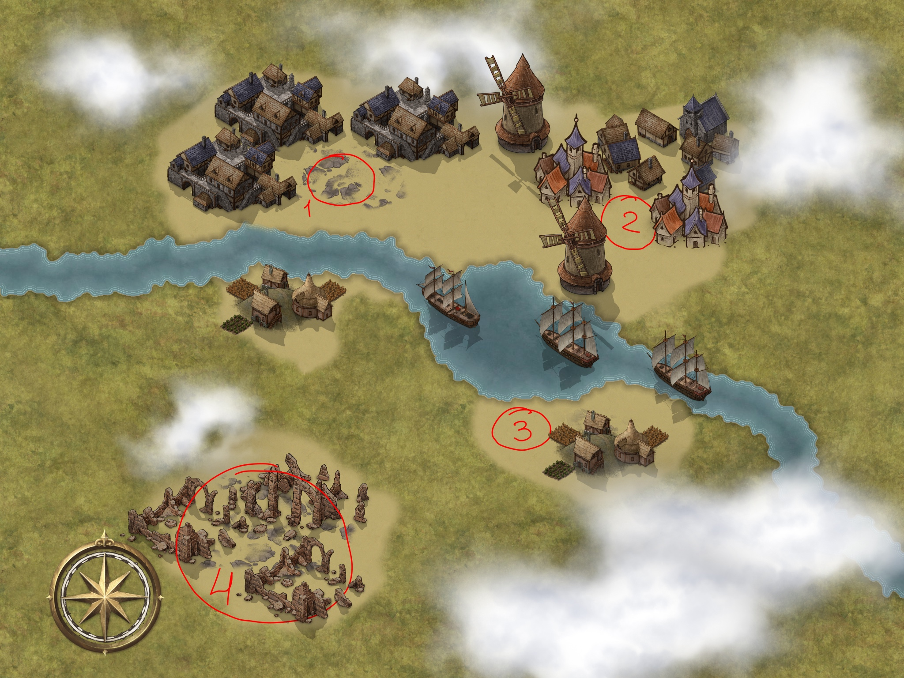

# S05. Концепт документ софты.docx

Извлечённый текст. Разметка адаптирована; исходный файл сохранён.

<!-- Блок 1 -->
Концепт мира

<!-- Блок 3 -->
Фракции-команды:

<!-- Блок 4 -->
Городская администрация

<!-- Блок 5 -->
Архитекторы

<!-- Блок 6 -->
Строители

<!-- Блок 7 -->
Мирные жители

<!-- Блок 8 -->
Тайный орден (церковь)

<!-- Блок 9 -->
Торговцы

<!-- Блок 11 -->
Подробнее:

<!-- Блок 12 -->
Городская администрация - управляет городом, предлагает идею башни и видит в ней ключ к развитию города. Некоторые представители городской администрации имеют магазины и рестораны в центре города, и у кого-то они пострадают при строительстве, а кто-то сможет выиграть за счёт привлечённых туристов. Все тайно хотят сэкономить на строительстве.

<!-- Блок 13 -->
Архитекторы проектируют башню. Их задача построить её привлекательной для туристов и при этом вписать башню в ландшафт.

<!-- Блок 14 -->
Строители пытаются построить башню по качеству, несмотря на фантазии архитекторов.

<!-- Блок 15 -->
Мирные жители в целом не против постройки башни, но против того что она будет строиться в жилом районе или на руинах.

<!-- Блок 16 -->
Тайный Орден знает, что строительство башни противоречит законам Высшей силы, поэтому всячески препятствует строительству. Ордену особенно противна мысль, что башня может стоять рядом с их священным храмом.

<!-- Блок 17 -->
Торговцы в целом заинтересованы в строительстве башни, при определённых условиях могут помочь со строительством, но все тоже в тайне хотят сэкономить.

<!-- Блок 19 -->
Ведущий:

<!-- Блок 20 -->
Высшая сила - создаёт правила игры, вводит ограничения, создаёт ивенты

<!-- Блок 21 -->
Проблема:

<!-- Блок 22 -->
Городская администрация решает заняться развитием города и предлагает построить башню. Башня решает несколько проблем города: 

<!-- Блок 23 -->
Проблема бизнеса: офисы многих предпринимателей, торговых альянсов и мастерские раскиданы по городу, что мешает налаживать деловые контакты. Башня станет деловым центром города.

<!-- Блок 24 -->
Проблема туризма: в городе нет значимых достопримечательностей, поэтому туристический поток города маленький. Стабильный туристический поток привлёк бы инвестиции и прибыль, поэтому башня также должна стать туристическим объектом.

<!-- Блок 25 -->
Социальная проблема: в городе практически нет зеленых зон, парков и скверов, что вызывает недовольство со стороны мирных жителей. Вокруг башни планируется разбить парк, но для этого должно быть достаточно территории.

<!-- Блок 27 -->
Места постройки башни:

<!-- Блок 28 -->
Городская площадь: Плюсы: центр города - удобно торговцам и предпринимателям, хорошее место для туристов; Минусы: мало места - парк построить не получиться, далеко от жилого квартала, дорогая земля, при строительстве необходимо убрать некоторые магазины и рестораны на площади, башня будет прямо рядом со зданием Тайного Ордена.

<!-- Блок 29 -->
Жилой квартал: Плюсы: местным удобно добираться, дешёвая земля; Минусы: мало места - для постройки башни требуется снести часть жилых домов, бизнесу неудобно переезжать, не туристическое место.

<!-- Блок 30 -->
Другой берег реки: Плюсы: город начнёт развиваться равномерно, а не только северный берег, самая дешёвая земля, много места - можно разбить огромный парк, есть туристический потенциал, через реку от жилого квартала; Минусы: нужно построить нормальный мост, имеющегося парома не хватит, дополнительные затраты на доставку материалов, очень мягкая почва - дополнительные затраты на фундамент, бизнес не заинтересован в переезде. Нюанс: если заинтересовать торговцев в строительстве башни на этом месте, они могут помочь с перевозкой материалов, что снизит затраты.

<!-- Блок 31 -->
Руины: Плюсы: дешёвая земля, много места - можно разбить огромный парк, есть туристический потенциал; Минусы: нужно построить нормальный мост и дорогу, дополнительные затраты на доставку материалов, бизнес не заинтересован в переезде, сопротивление со стороны жителей - так как руины памятник исторического наследия, а для строительства башни надо снести часть руин. Нюанс: если выбрано это место, потом в игре может обнаружиться, что исследования почвы было проведено неправильно, и из-за песчаной почвы нужно укреплять фундамент, а это дополнительные затраты.

## Текстовое описание карты

Иллюстрация города у реки. Сверху расположены плотная застройка, мельницы и группа зданий с синими крышами; на реке показаны суда и переправа. На нижнем берегу — отдельные дома, юго-западнее — руины с каменными колоннами. Красными обводками отмечены четыре площадки: 1 — среди верхней левой городской застройки; 2 — возле группы зданий справа; 3 — на нижнем берегу у домов; 4 — руины внизу слева. Сопоставление с перечнем мест (площадь, жилой квартал, другой берег, руины) следует из контекста документа; сами названия на карте не подписаны. Это иллюстрация выбора площадки, численных расстояний и стоимости на ней нет.

